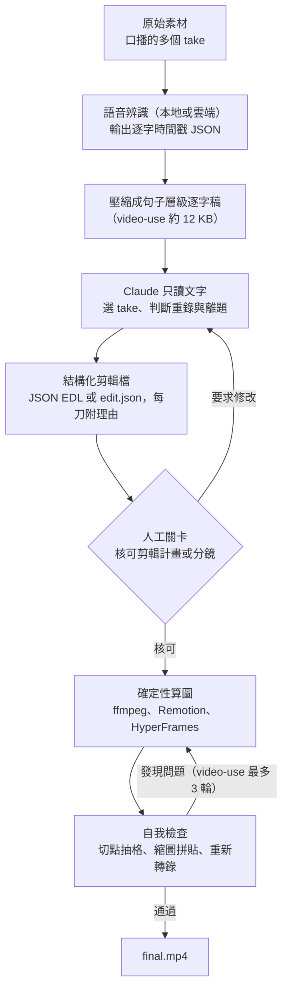

# Claude Code 剪短影音：讀逐字稿，不看畫面

截至 2026 年 11 月，用 Claude Code（Anthropic 的命令列程式開發代理）製作 IG Reels、Shorts、TikTok 直式短影音的人，幾乎都把它當成「指揮」，而不是會看畫面的剪輯師。做法是本地腳本先把語音轉成帶逐字時間戳的逐字稿，Claude 只讀文字，寫出一份結構化剪輯檔，也就是 JSON（常見的結構化文字資料格式）寫成的 EDL（edit decision list，剪輯決策清單）。人工核可後，這份剪輯檔交給 ffmpeg（開源影音處理命令列工具），或 Remotion、HyperFrames 這類「用程式碼產生影片」的框架做確定性算圖（同樣輸入必得同樣畫面），最後再抽影格自我檢查。這套做法建立在 2026 年才成形的開源生態上：browser-use 的 video-use（30,861 個 GitHub stars，即收藏數）、HeyGen 的 HyperFrames（82,127 stars）與 Remotion 官方的 13 個 agent skill。三者都以 skill（Claude Code 的 `SKILL.md` 指令包，可附腳本）發布，而不是 MCP server（MCP 即 Model Context Protocol，讓模型呼叫外部工具的協定）。subagent（擁有獨立上下文的輔助代理）只在「每段動畫一個 subagent」的平行算圖中出現；hook（Claude Code 在特定事件自動執行的指令）在任何影片案例中都沒有紀錄。ffmpeg 的 MCP server 放在本來就能下 shell（命令列環境）指令的 Claude Code 裡多半多餘；DaVinci Resolve、Premiere、Final Cut 與剪映／CapCut 這些剪輯軟體的橋接專案，則是為「交給剪輯軟體收尾」的流程而做，而且各自受限於付費版、作業平台或草稿格式加密。台灣華語是最大的在地化缺口：原版 Whisper（OpenAI 的開源語音辨識模型）在台灣華語的公開數字明顯落後阿里巴巴的 Qwen3-ASR 與聯發科的 Breeze-ASR-25；所有引擎都得靠 OpenCC（開源簡繁轉換工具）轉成台灣正體；缺中文字型、CJK（中日韓文字）斷行、字幕遮臉則在各案例中反覆出錯。沒有任何公開案例同時涵蓋口播粗剪、字幕、特效與 2D 動畫，並附上每支影片的實測成本；架構最完整的第一方案例是 Anthropic 在 2026 年 6 月讓 Fable（Anthropic 的模型之一）剪自己的發表影片，那還是一支橫式長片。對我們的工作流，證據支持的骨架如下：每個階段一個 skill 加確定性腳本、一份剪輯 JSON 貫穿全程、本地 MLX（Apple 晶片的機器學習框架）版語音辨識、動畫鎖在範本內，並在逐字稿校對、剪輯計畫、樣張三處設人工關卡。

> 研究基準日 2026-11-11。標記說明：**snippet-only** 指只在搜尋結果摘要中看到、原頁未讀取；**UNVERIFIED** 指未能對照原始來源確認；**HYPOTHESIS** 指由已知資料推論、尚未實際執行驗證；**self-reported** 指作者或廠商自述的數字。GitHub stars 與「最後 push」（最後一次推送程式碼到任一分支的日期）均為 2026-11-11 透過 GitHub API（應用程式介面）或頁面擷取的值。本次研究沒有找到 Reddit 或 Hacker News 上的第一手工作流報告，也沒有讀到 Bilibili、小紅書、Threads、方格子、iThome、少數派的原頁。

## 公開案例都走同一條路：讀逐字稿、寫剪輯檔、腳本算圖、抽格自檢

第一方紀錄中最詳細的一份來自 Anthropic 的 Claude Code 團隊。這支約 3 分鐘的 4K 口播（talking-head，對著鏡頭說話）發表影片由 @ClaudeDevs 在 2026-06-09 發布，主導者是團隊成員 Thariq，他「never opened a video editor」。素材是 **17 個 take（同一段內容的一次拍攝）、4 個場景、約 25 GB 的 Sony S-Log3**（Sony 的 log 色彩曲線，要經過色彩管理才能還原正常畫面）。流程依序如下：Whisper 產生逐字時間戳 JSON；Claude 寫出每個選擇都附理由的 JSON EDL `final-edit.json`；ffmpeg 剪接；Claude 重新轉錄成品，檢查口癖（「嗯」「呃」這類填充詞）有沒有刪乾淨；Claude 寫 7 個候選 LUT（look-up table，調色查找表），由人挑一個；11 張設計師 PNG 圖片重建成參數化 Remotion 元件，跟著口白時間點出現；透過 Figma（介面設計工具）的 MCP 做兩次「程式→Figma→程式」的設計來回；最後算圖、截靜態畫面自審、再算圖。第一版 2:50 的剪輯在「within minutes」內完成，**一晚重算約 10 次，總計 4 天（6 月 6–9 日）**。token（模型計量與計費單位）與運算成本沒有公布；一位調色師指出 S-Log3 素材沒有正確做色彩管理 ([jc-aiwiki 摘要，二手](https://jc-aiwiki.pages.dev/ai-video-content/fable-edits-own-launch-video); [Thariq 簡報「Claude Code · June 2026」](https://thariqs.github.io/cc-video-editing-deck/); [X @ClaudeDevs](https://x.com/ClaudeDevs/status/2064399512664526853))。這是橫式長片，不是 Reel，但整個架構攤在眼前。

開源專案把同一套邏輯做成可安裝的 skill。video-use 的 README 直說「The LLM never watches the video. It reads it.」（LLM 即 large language model，大型語言模型）。它用雲端語音辨識服務 ElevenLabs Scribe 產生逐字稿，內含逐字時間戳、語者分離（diarization，標出誰在說話）與音訊事件，所有 take 再壓成約 **12 KB 的 `takes_packed.md`**。只有到了決策點和切點，它才呼叫 `timeline_view`，產生含膠卷縮圖、波形與字標的 PNG。成品會在每個切點自檢，最多修正重算 3 輪 ([GitHub browser-use/video-use](https://github.com/browser-use/video-use))。作者估算，逐格把畫面餵給模型約需 30,000 格 × 1,500 tokens ≈ 4,500 萬 tokens，對比「12KB text + a handful of PNGs」；這是自述估算，未經獨立驗證。claude-shorts（MIT 開源授權，368 stars）用 faster-whisper（Whisper 的加速實作）取得逐字時間戳，讓 Claude 依加權評分表替 8–12 個候選片段打分（開場吸引力 0.30、獨立完整性 0.25、情緒 0.20、資訊密度 0.15、收尾 0.10，門檻 60/100），再用 `snap_boundaries.py` 把切點對齊字尾與靜音 ([GitHub AgriciDaniel/claude-shorts](https://github.com/AgriciDaniel/claude-shorts))。DEV 上的 video-editing-skill（貼文日期 Oct 30，未標年份）讓 Claude 只讀每句一行的 `transcript.txt`，寫出每刀附理由的 `edit.json`（例如 `[61.2, 74.8, "tangent about the weather"]`）；口癖、結巴與重錄則交給程式規則處理 ([DEV Community](https://dev.to/fheijdenrijk/video-editing-skill-for-claude-code-an-agent-that-plans-every-cut-then-renders-with-ffmpeg-518a))。下圖是這些專案共同的流程：



各案例的第二個共同點是人工關卡，而且關卡實際上也在控制成本。video-use 提出剪輯策略後「waits for approval before touching any cut」，原則是 Ask → confirm → execute → self-eval → persist ([GitHub browser-use/video-use](https://github.com/browser-use/video-use))。Clixie 把 HTML 分鏡計畫當成「the main human gate」，並用「Do not render anything yet.」先跑一輪只出分鏡的流程 ([Clixie](https://www.clixie.ai/blog/claude-code-video-editing))。台灣的 Abby Chi（2026-10-23）建議依序做幾件事：先確認分鏡；看開頭、中段、結尾三張關鍵畫面；刪停頓前，先審閱附時間碼與理由的刪除清單；先用 2–3 秒片段試算圖 ([abbychi.com](https://abbychi.com/claude-video-editing-animation-guide/))。remotion-shorts-skill（DEV 貼文日期 Nov 3，未標年份，因此是 2025 或 2026 年）把關卡寫進程式：`--stills` 幾秒內就產出 `sheet.jpg`、`cuts.jpg`、`cover.jpg` 與 `report.json`，只要有警告就以 exit code 2 中止算圖 ([DEV Community](https://dev.to/fheijdenrijk/remotion-skill-for-claude-code-finished-shorts-from-one-json-file-checked-before-render-m23))。

有時間或用量數字的案例只有下列幾個，而且多數是自述：

| 案例（日期） | 素材 → 產出 | 主要工具鏈 | 回報的時間／用量 | 已知限制 |
|---|---|---|---|---|
| [Anthropic Fable 發表影片](https://jc-aiwiki.pages.dev/ai-video-content/fable-edits-own-launch-video)（2026-06） | 17 個 take、約 25 GB S-Log3 4K → 約 3 分鐘橫式 | Whisper、JSON EDL、ffmpeg、Remotion、Figma MCP | 一晚約 10 次重算，總計 4 天；成本未公布 | 不是 Reel；色彩管理不足 |
| [追日Gucci](https://www.guccidgi.com/2026/07/claude-code-video-editing-pipeline/)（台灣，2026-07-05） | 28 分鐘錄影 → 約 14 分鐘 | 12 個 skill、「20+」剪輯機制、「610+」自動化測試；以 Remotion 或 HyperFrames 做動畫 B-roll（穿插在主畫面間的補充畫面）；Suno（AI 音樂生成服務）配樂 | 後製 6–7 小時 → 約 30 分鐘審核（self-reported，帶宣傳性質） | 以長片為主 |
| [Isaac's Substack 測 claude-shorts](https://isaacwong2024.substack.com/p/claude-20-40-460)（香港，2026-08-03） | 約 50 分鐘粵語影片 → 7 支 shorts | faster-whisper、MediaPipe（Google 的開源電腦視覺工具）、Remotion 字幕 | 約 40 分鐘（不含首次安裝） | 粵語辨識錯誤、字幕偶有時間偏移、沒有 B-roll 與動畫 |
| [Isaac's Substack 測 Ghost Editor v0.3.0](https://isaacwong2024.substack.com/p/ghost-editor-claude-code-reel)（2026-11-08） | 口播 → 1080x1920 Reel | 本地轉錄、刪靜音、避臉字幕、特效；需要 Apple Silicon Mac 與付費 Claude 方案 | 約 30 分鐘、7 個版本、用掉約 44% 用量上限（可讀內文未見方案等級） | 內建字幕字型不含中文；特效遮臉或太小、剪得不夠 |
| [Clixie](https://www.clixie.ai/blog/claude-code-video-editing)（廠商部落格，2026-05-28 更新） | 37 秒口播 | Claude Code + HyperFrames | 算圖 4 次；上下文到 263K tokens 時必須重置；約佔 US$200/月 Max 方案 5 小時額度的 10% | 頁面含未填的佔位符，屬廠商草稿 |

這些數字指向同一件事：**吃掉額度的是修改輪數，不是第一輪**。Ghost Editor 那次 7 個版本用掉約 44% 用量上限，作者把多輪修正歸咎於第一句提示太含糊（「第一句太含糊，後面就會變成多輪修正」）([Isaac's Substack](https://isaacwong2024.substack.com/p/ghost-editor-claude-code-reel))。Clixie 建議上下文（模型一次能看到的內容範圍）到 200–260K tokens 時寫一份交接摘要、開新的工作階段，並警告在 260K 以上的工作階段裡繼續修改，會讓規劃品質下降、成本加速累積 ([Clixie](https://www.clixie.ai/blog/claude-code-video-editing))。另有一則 snippet-only 的 Anthropic 支援頁摘要指出，Pro 與 Max 方案的 Claude 與 Claude Code 共用同一個用量池 ([Anthropic support](https://support.anthropic.com/?q=terminen))。沒有任何第一手來源提供每支影片的 token 數或美元成本，也沒有 Pro 方案的使用經驗。品質評價同樣保守：Isaac 稱 claude-shorts 是「一個聰明的長片切片工具」，不是完整的 AI 剪輯師；Clixie 的作者說「I wouldn't post this, but it's getting better.」。中文圈的教學並不少，例如台灣的 YouTube 零基礎教學 ([YouTube](https://www.youtube.com/watch?v=lP0rUMMIhKU)，snippet-only)，以及提醒訂閱費、模型用量與素材可能另外計費的 HyperFrames 繁中指南 ([aiposthub](https://www.aiposthub.com/claude-code-hyperframes-video-editing-guide/)，snippet-only)。至於 video-use 的推出日期，各來源說法不一，2026 年 4 月的證據較充分。

## Skill 是主要封裝單位，subagent 只負責平行算動畫，MCP 多半在邊緣

公開專案的封裝方式有兩種：「一個引擎一組 skill」，以及「一個 skill 裡每個步驟一支腳本」。前者的例子是 HyperFrames 的 `/hyperframes`、`/hyperframes-cli`、`/media-use`（配樂、旁白、圖片、logo、調色），以及 Remotion 的 `/remotion-studio`、`/remotion-render`、`/remotion-captions` ([GitHub heygen-com/hyperframes](https://github.com/heygen-com/hyperframes); [Remotion docs: Agent Skills](https://www.remotion.dev/docs/ai/skills))。後者的例子是 claude-shorts：一個 `/shorts` slash command（斜線指令），搭配 `SKILL.md`、`CLAUDE.md` 與一組確定性腳本，例如 `transcribe.py`、`detect_content.py`（用 MediaPipe 分辨口播、螢幕錄影與 podcast）、`compute_reframe.py`（追蹤臉部與游標），另附 `scoring-rubric.md`、`caption-styles.md`、`platform-specs.md` 等參考檔 ([GitHub AgriciDaniel/claude-shorts](https://github.com/AgriciDaniel/claude-shorts))。video-use 則把「production rules and editing craft」與「12 hard rules」寫進 `SKILL.md`，剪輯腳本放在 `helpers/` ([GitHub browser-use/video-use](https://github.com/browser-use/video-use))。追日Gucci 的私人流程把兩種做法都放大到 12 個 skill，每個步驟可以單獨開關，也可以「Full Auto」([guccidgi.com](https://www.guccidgi.com/2026/07/claude-code-video-editing-pipeline/))。發布管道是 Claude Code plugin（可從外掛市集一次安裝多個 skill 等元件的套件），例如先 `claude plugin marketplace add heygen-com/hyperframes`，再 `claude plugin install hyperframes@hyperframes`。

依官方文件，subagent 是放在 `.claude/agents/`（專案層級）或 `~/.claude/agents/`（使用者層級）的 Markdown 檔，可以指定 `tools`、`model`（`sonnet`、`opus`、`haiku`、`fable`、完整模型 ID 或 `inherit`）、預載的 `skills`、只對該 subagent 生效的 `hooks`，以及 `memory`。subagent 有自己的上下文，只回傳摘要，預設最多巢狀三層。文件明說把例行工作交給 Haiku 是控制成本的方式，但 subagent 用掉的 token 仍計入同一個用量上限 ([Claude Code docs: subagents](https://code.claude.com/docs/en/sub-agents))。實務上，只有 video-use 在文件中寫明使用 subagent：動畫疊層「in parallel sub-agents, one per animation」；claude-shorts 完全沒提 ([GitHub browser-use/video-use](https://github.com/browser-use/video-use))。沒有來源顯示有人把 Haiku 或 Sonnet 的 subagent 用在影片步驟，也沒有來源用 hook 處理影片（例如寫檔後自動驗證剪輯檔）。兩者在文件上都是可用的手段，但實務中還沒人這樣用。

ffmpeg 的 MCP server 多半只是把單一 ffmpeg 操作包成一個工具，而且不少已經停止更新。misbahsy/video-audio-mcp 列出 27 個工具（README 卻寫「30+ tools」），90 stars，建立日與最後 push 同為 2025-05-24 ([GitHub misbahsy/video-audio-mcp](https://github.com/misbahsy/video-audio-mcp))；video-creator/ffmpeg-mcp 有 153 stars，最後 push 為 2026-05-20 ([GitHub video-creator/ffmpeg-mcp](https://github.com/video-creator/ffmpeg-mcp))。PedroMarianoAlmeida/ffmpeg-mcp 的 `ffmpeg_raw` 工具能執行任意 ffmpeg 指令 ([Socket listing](https://socket.dev/npm/package/ffmpeg-mcp-server))，等於放棄了 MCP 限縮操作範圍這個唯一的好處。MCP 的額外成本來自工具 schema（工具的參數定義）必須載入上下文。部落格的量測從約 1,300 到約 44K tokens 不等，全是 snippet-only 的非對照量測 ([Firecrawl](https://www.firecrawl.dev/blog/mcp-vs-cli); [dev.to](https://dev.to/pickuma/cli-vs-mcp-which-tool-interface-actually-works-for-ai-coding-agents-1894))。另有一項 HYPOTHESIS：Claude Code 會延遲載入 MCP 工具 schema，可能縮小這個差距，但尚未對照 Claude Code 官方文件確認。stars 最多的代理剪輯專案 video-use 本身就是直接驅動 ffmpeg 的 skill，不是 MCP。ffmpeg MCP 只在兩種情境下說得通：使用沒有 shell 的 Claude 桌面 App，或想把代理限制在白名單操作內。

剪輯軟體的橋接比 ffmpeg MCP 成熟，但前提都是最後要在 NLE（non-linear editor，非線性剪輯軟體）裡收尾：

| 目標軟體 | 代表專案（stars／最後 push） | 運作方式 | 關鍵限制 |
|---|---|---|---|
| DaVinci Resolve | [samuelgursky/davinci-resolve-mcp](https://github.com/samuelgursky/davinci-resolve-mcp)（4,035／2026-11-10，MIT） | 預設 37 個整合工具，`--full` 時 390 個；`npx davinci-resolve-mcp setup` 可設定 Claude Code | Resolve 21.1 把 Python 腳本功能移到付費 Studio 版；README 明說不負責挑最佳 take，也不判斷剪得好不好 |
| Premiere Pro | [hetpatel-11/Adobe_Premiere_Pro_MCP](https://github.com/hetpatel-11/Adobe_Premiere_Pro_MCP)（846／2026-11-02，MIT） | 透過 CEP（Adobe 的擴充套件架構）橋接，283 個工具，可當 Claude Code plugin 安裝 | 只有 macOS 完整驗證，Windows 只做過安裝冒煙測試；README 自稱「not magic」 |
| Final Cut Pro | [DareDev256/fcp-mcp-server](https://github.com/DareDev256/fcp-mcp-server)（145／2026-11-02，MIT） | 讀寫 FCPXML（Final Cut 的時間軸交換格式）；live mode 可推入執行中的 Final Cut | 只能在 macOS 用；Final Cut 沒有程式化匯出，XML 要手動匯出 |
| 剪映／CapCut | [pyJianYingDraft](https://github.com/GuanYixuan/pyJianYingDraft)（4,864／2026-10-14）、[VectCutAPI](https://github.com/sun-guannan/VectCutAPI)（2,370／2026-11-07）、[capcut-mate](https://github.com/Hommy-master/capcut-mate)（2,126／2026-11-08） | 直接產生草稿檔，讓創作者在 App 裡開啟微調 | 逆向工程未公開格式；草稿仍須在 Windows 版剪映匯出，自動匯出只支援剪映 6.8 以下 |

這些橋接是否可靠，取決於表格以外的細節。Resolve 方面，Puget Systems（2026-09-10）引述 21.1 版說明「We have moved the ability to script in Python to the Studio version」，並稱免費版已完全移除腳本功能；Digital Production（2026-09-08）則說免費版仍可從主控台使用腳本 API，只有外部腳本需要 Studio。兩邊說法部分矛盾 ([Puget Systems](https://www.pugetsystems.com/blog/2026/09/10/how-davinci-resolve-free-v21-1-scripting-changes-affect-puget-bench/); [Digital Production](https://digitalproduction.com/2026/09/08/resolve-21-1-adds-mcp-and-finally-gets-presets/))。samuelgursky 的 README 自稱免費版的 App 內橋接是「a supported-until-it-is-not tier」，21.1 免費版能不能用尚未確認。另一方面，Resolve Studio 21.1 內建原生 MCP server，可連接 Claude、Claude Code 與 ChatGPT Codex；Studio 是一次買斷授權，US$295 這個價格來自搜尋摘要，未對照 Blackmagic 商店。時間軸交換格式也只帶得走剪接本身：OTIO（OpenTimelineIO，開放的時間軸交換格式）承載剪點、軌道、速度與標記，Adobe 列出的支援項目沒有特效、轉場與標題。Adobe 在 2025-02-12 表示，Premiere 的 OTIO 支援仍未達正式版標準 ([Adobe community](https://community.adobe.com/announcements-732/now-released-otio-import-and-export-311699))。剪映／CapCut 的風險最大：pyJianYingDraft 的 README 說新版剪映的 `draft_content.json`「往往不是可直接读取的明文 JSON」，剪映 7 起又隱藏了匯出控制項。社群另回報 CapCut 8.7 以上會忽略或拒絕工具寫出的草稿，這點 UNVERIFIED，也沒有官方說法 ([pyJianYingDraft README](https://github.com/GuanYixuan/pyJianYingDraft); [capcut-cli version-support](https://raw.githubusercontent.com/renezander030/capcut-cli/master/docs/version-support.md))。

要讓代理「看見」自己的成品，目前有三條路。最便宜的是用 ffmpeg 抽格，或把多格拼成 contact sheet（縮圖拼貼），讓 Claude 讀 PNG。依官方公式，每張圖花費 ⌈寬/28⌉ × ⌈高/28⌉ 個視覺 token。在高解析度級（Claude 4.7 以後的模型）上，一張 1080x1920 影格約 2,691 tokens，以 Claude Opus 5.5 每百萬輸入 token US$4 計，約 US$0.011；單次請求超過 20 張圖時，會套用更嚴格的尺寸限制 ([Claude vision docs](https://platform.claude.com/docs/en/build-with-claude/vision))。由公式推算（未實測）：9 格或 16 格拼成一張 1080x1920 的 contact sheet，成本與單張相同，每格只約 300 或 170 tokens；60 秒 Reel 若每秒抽一張全解析度影格，則約 161,000 tokens。第二條路是 Gemini（Google 的多模態模型）直接讀影片，約每秒 100 tokens，看得到動態與聲音，但需要 Google API key 並上傳素材 ([Gemini API video understanding](https://aistudio.google.com/docs/video-understanding))。第三條路是 Twelve Labs（影片理解服務）官方託管的 MCP，偏向素材庫搜尋，在 Claude Code 中只回傳文字答案 ([Twelve Labs MCP docs](https://docs.twelvelabs.io/docs/advanced/model-context-protocol))。素材方面，LottieFiles 有官方託管 MCP（頁面 2026-11-10 更新），可以管理工作區裡的 Lottie（JSON 格式的向量動畫）檔，但要算成影片仍需另外的算圖器 ([LottieFiles MCP docs](https://docs.lottiefiles.com/en/platform/mcp))；Pexels、Pixabay 這類圖庫與圖像生成的 MCP 都是社群專案。音樂授權只找到二手廠商部落格：Instagram 的商業帳號只能使用 Meta 商用音樂庫或另行授權的曲目，在說明文字標註出處不等於取得授權 ([ScreenApp](https://screenapp.io/blog/how-to-use-copyrighted-music-on-instagram-legally))。

## 台灣華語是最大缺口：辨識引擎要換，口癖規則要重寫

每一份中文（含粵語）實測都碰上了 ASR（automatic speech recognition，自動語音辨識）錯誤。Isaac 測 claude-shorts 時遇到粵語辨識錯誤與字幕時間偏移；測 Ghost Editor 時，Whisper 聽錯粵語詞，只能對照字幕稿校正 ([Isaac 2026-08-03](https://isaacwong2024.substack.com/p/claude-20-40-460); [Isaac 2026-11-08](https://isaacwong2024.substack.com/p/ghost-editor-claude-code-reel))。追日Gucci 為中文另寫了幾套規則：依句子與名詞邊界斷行、刪除結巴與口癖、數字正規化（含中文數字），外加一份會「學習修正」的術語表 ([guccidgi.com](https://www.guccidgi.com/2026/07/claude-code-video-editing-pipeline/))。Abby Chi 與 maplefeather 都要求先提供專有名詞清單，並在上字幕前人工校對逐字稿 ([abbychi.com](https://abbychi.com/claude-video-editing-animation-guide/); [maplefeather](https://maplefeather.com/article/ai-auto-video-editing-claude-code-2026))。Clixie 另指出，轉錄 API 給的字邊界可能偏移約 120 ms，在每秒 30 格（fps）下約四格，誤差會隨切點累積 ([Clixie](https://www.clixie.ai/blog/claude-code-video-editing))。下表整理可在本機執行、且有台灣華語相關數字的引擎；表中 WER 是 word error rate（詞錯誤率），CER 是 character error rate（字錯誤率），數字越低越好：

| 引擎 | 發布與授權 | 台灣華語相關公開數字 | 時間戳 | 在 Mac 上執行 | 主要限制 |
|---|---|---|---|---|---|
| [Qwen3-ASR-1.7B](https://github.com/QwenLM/Qwen3-ASR) + Qwen3-ForcedAligner | 2026-01-29，Apache-2.0；2026-06-26 起原生支援 Hugging Face Transformers | CV-zh-tw 3.77（README 標為 WER）；0.6B 為 5.59；Whisper-large-v3 為 7.84 | ForcedAligner 給字級時間戳，中文 AAS 33.1 ms；每次最多 5 分鐘語音；串流模式不給時間戳 | 社群 MLX 版 [mlx-qwen3-asr](https://github.com/moona3k/mlx-qwen3-asr/) | 官方 README 只有 CUDA（NVIDIA 的 GPU 運算平台）範例；未說明能否輸出正體 |
| [Breeze-ASR-25](https://huggingface.co/MediaTek-Research/Breeze-ASR-25)（聯發科） | 論文 2025-06-10，Apache-2.0；由 Whisper-large-v2 微調，約 2B 參數 | CommonVoice16-zh-TW 7.97（v3 為 8.95）；中英夾雜集 CSZS-zh-en 13.01（v2 為 29.49）；卡片標為「WER」，中文指標定義 UNVERIFIED | 支援 `return_timestamps=True`，卡片稱「enhanced time alignment」 | 非官方的 MLX、GGML（whisper.cpp 用的格式）、CTranslate2 轉檔 | MLX 最佳化路徑沒有逐字時間戳、只收短音訊；Formosa-Course 集略遜 v2 |
| Whisper large-v3／large-v3-turbo | — | 中文各測試集 turbo 都比 v3 差，例如 AISHELL-1 為 8.639 對 8.085 ([Belle card](https://huggingface.co/BELLE-2/Belle-whisper-large-v3-turbo-zh)) | whisper.cpp 的逐字時間戳屬 experimental | mlx-whisper 約比 whisper.cpp 快 2 倍（M1 Ultra） | 沒有簡繁設定；large-v3 有單字或片語異常重複的問題 ([arXiv 2507.16843](https://arxiv.org/pdf/2507.16843)) |
| [WhisperX](https://github.com/m-bain/whisperX) | — | — | 中文對齊模型以簡體訓練，每個字各有一個時間戳 | README 只給以處理器、8 位元整數模式執行的指令 | 對齊器不是以台灣用語訓練 |
| [FireRedASR2](https://huggingface.co/FireRedTeam/FireRedASR2-AED/blob/refs%2Fpr%2F1/README.md) | 2026-02-12，Apache-2.0 | 華語平均 CER 2.89（LLM 版）；沒有 zh-TW 結果 | 未說明 | 未說明 | — |
| NVIDIA Parakeet／Canary | 2025 | 不支援中文 ([arXiv 2509.14128](https://arxiv.org/pdf/2509.14128)) | — | — | — |

在公開數字上，**Qwen3-ASR-1.7B 在 CV-zh-tw 的 3.77，不到 Whisper-large-v3（7.84）的一半**；Breeze-ASR-25 在中英夾雜（code-switching，語碼轉換）測試集 CSZS-zh-en 上，把錯誤率從 Whisper-large-v2 的 29.49 降到 13.01（-55.88%）。但兩組數字都由各自的作者在不同測試集上回報，找不到第三方做的台灣華語中英夾雜對照。Qwen3-ForcedAligner 做的是強制對齊（已知文字，找出每個字在音訊中的時間），中文的 AAS（accumulated average shift，累積平均時間偏移）為 33.1 ms，NeMo Forced Aligner 則是 109.8 ms ([arXiv 2601.21337](https://arxiv.org/html/2601.21337))，最適合用來做逐字跳字幕。Whisper 沒有簡繁設定，用正體提示詞引導在 large-v3 上不可靠 ([openai/whisper #277](https://github.com/openai/whisper/discussions/277))。WhisperX 的中文對齊模型是簡體訓練的 `wav2vec2-large-xlsr-53-chinese-zh-cn` ([whisperX alignment.py](https://raw.githubusercontent.com/m-bain/whisperX/main/whisperx/alignment.py))。FunASR 家族中，Paraformer-zh 提供毫秒級字時間戳與熱詞，Fun-ASR-Nano 的開放權重據報缺少訓練過的時間戳頭，時間戳不可靠 ([FunASR model_selection.md mirror](https://gh.mise.run.place/modelscope/FunASR/blob/main/docs/model_selection.md); [mlx-audio Fun-ASR-Nano](https://blaizzy.github.io/mlx-audio/models/stt/fun-asr-nano/))。

由於沒有引擎保證輸出含台灣用語的正體，OpenCC 是每條流程的固定一環。目前版本 1.4.2；`s2tw` 逐字轉成台灣標準字，`s2twp` 再加上台灣片語（数据库→資料庫、鼠標→滑鼠），使用者字典可以覆寫特定詞 ([BYVoid/OpenCC](https://github.com/BYVoid/OpenCC))。`s2twp` 的片語替換可能改變字串長度（U盘→隨身碟），所以安全的順序是：先在辨識原文上對齊字級時間戳，再以整條字幕為單位跑 `s2twp`，或逐字只跑 `s2tw`。這個順序是 HYPOTHESIS，需要用真實輸出確認哪些詞條會改變長度。Breeze-ASR-25 源自 Whisper-v2，可能也承襲長音訊的靜音幻覺與重複迴圈，因此建議先用 VAD（voice activity detection，語音活動偵測）切段；這同樣是未測試的 HYPOTHESIS。術語表可以同時當成辨識提示（引擎支援時）與辨識後的替換表，Claude 只需維護這張表，不必重讀整份逐字稿抓錯字。

在 Mac 上，速度不是瓶頸。在 Apple M4 Pro（48 GB 記憶體）上，mlx-qwen3-asr v0.4.0（benchmark 日期 2026-09-07）的 RTF（real-time factor，處理時間除以音訊長度，越小越快）為：0.6B fp16 0.029、1.7B fp16 0.077（fp16 是 16 位元浮點精度），記憶體分別約 1.2 GB 與 3.4 GB；它的原生 MLX 對齊器與官方後端相比，時間的平均絕對誤差（MAE）為 5.69 ms ([moona3k/mlx-qwen3-asr](https://github.com/moona3k/mlx-qwen3-asr/))。Breeze-ASR-25 的 MLX 轉檔在 BF16（另一種 16 位元浮點格式）下為 14.7 倍即時，在 CV16.1 zh-TW 經 OpenCC 轉換後的 CER 為 9.78%；但它的最佳化路徑「does not provide word timestamps with fused attention」，而且只收短音訊 ([MarkChen1214/Breeze-ASR-25-MLX-5bit](https://huggingface.co/MarkChen1214/Breeze-ASR-25-MLX-5bit))。依這些 RTF 外推，5 分鐘片段在 M4 級 Mac 上的 ASR 約 9–25 秒，含算圖的總運算約 2–6 分鐘，真正耗時的是人工審閱；8 GB 的 M1/M2 應改用 0.6B 或 Breeze 的 Q5（5 位元量化，約 1.07 GB）版本。以上都是 HYPOTHESIS，目前沒有任何 8–16 GB 基本款晶片的端到端實測。

粗剪的分工已經成形：**靜音、口癖、結巴交給規則處理，Claude 只判斷重錄、離題與重複句**。auto-editor（依音量或畫面變化自動刪靜音的工具）31.6.1 版（參考頁產生於 2026-09-07）預設以音訊判斷，門檻 0.04，`--margin` 0.2 秒，也能用 `(or (audio 0.05) (motion 0.02))` 組合條件 ([auto-editor options](https://auto-editor.com/ref/options); [auto-editor --edit](https://auto-editor.com/ref/edit))。不過 maplefeather（2026-11-01 更新）回報，它只看音量，會把刻意的停頓剪掉，必須調整門檻 ([maplefeather](https://maplefeather.com/article/ai-auto-video-editing-claude-code-2026))。DEV 的 video-editing-skill 規則可以當範本：um、uh 這類口癖只在兩側都有空隙時才刪；結巴定義為間隔小於 0.25 秒的重複詞；8 個詞以內的未完成片段，若後一句開頭相同，只保留最後一次；**完整的重複句一律不自動刪，只列出來給代理與使用者判斷**。切點對齊影格，並加 4 ms 的音訊淡入淡出 ([DEV Community](https://dev.to/fheijdenrijk/video-editing-skill-for-claude-code-an-agent-that-plans-every-cut-then-renders-with-ffmpeg-518a))。這些規則都靠英文的空格斷詞，套到華語必須改寫。呃、嗯、啊可以直接列為口癖，但「那個」「就是」「然後」同時是實詞，只能在被停頓隔開時才刪；結巴與重錄的偵測要改以字或中文斷詞結果（例如 jieba 斷詞工具）為單位，相鄰兩句重疊 ≥50% 就列為重錄候選、保留最後一次。這套華語改寫是 HYPOTHESIS，門檻需要在真實素材上調整；目前沒有任何來源評估過華語口癖或重錄偵測的準確率。

## 字幕與輸出：CJK 斷行、安全區與 HDR 轉換都得自己寫

字幕的實務選擇是 ASS（Advanced SubStation Alpha，可帶樣式與逐字卡拉 OK 效果的字幕格式），搭配 libass（ASS 的渲染函式庫）由 ffmpeg 燒進畫面，但**斷行必須自己做**。ffmpeg 的 `subtitles` 濾鏡在 2023 年 5 月加入 `wrap_unicode` 選項，但 libass 必須連同 libunibreak（Unicode 斷行函式庫）編譯，而且這個選項對原生 ASS 輸入預設關閉 ([FFmpeg-devel](https://ffmpeg.org/pipermail/ffmpeg-devel/2023-May/310087.html))。開源播放器 mpv 的原始碼註解也直說，沒有空格的 CJK 字幕「might overflow the screen」，「and ffmpeg doesn't」幫忙插入換行 ([mpv osd_libass.c](https://git.tjdev.de/mirror/mpv/src/commit/180b4faed0d7aed075c22cf3ac52cf9fc4a64860/sub/osd_libass.c))。有網頁稱 Homebrew（macOS 套件管理器）預設的 ffmpeg 沒有 libass，需要改裝 `ffmpeg-full`；此說 UNVERIFIED，可用 `ffmpeg -filters | grep -E "ass|subtitles"` 自行確認 ([skillselion](https://skillselion.com/skills/josiahsiegel/claude-plugin-marketplace/ffmpeg-karaoke-animated-text))。逐字高亮用 ASS 的 `\k`、`\kf` 標籤，單位是百分之一秒（`{\k50}` = 0.5 秒）([n8n workflow](https://n8n.io/workflows/18486-burn-word-highlighted-karaoke-captions-onto-videos-with-ffmpeg-and-ffprobe/))，有 Qwen3-ForcedAligner 的字級時間戳就能直接換算。排版規則可以借用 Netflix 的正體中文字幕規範：每行最多 16 字、最多 2 行（偏好 1 行）、每秒不超過 9 字、使用全形標點、不加句號、行尾不留逗號、數字用半形且不加千分位 ([Netflix Partner Help](https://partnerhelp.netflixstudios.com/hc/en-us/articles/215994807-Traditional-Chinese-Timed-Text-Style-Guide))。

位置方面，Meta 官方廣告規格要求文字與 logo 避開上方至少 14%、下方約 35%、左右各約 6% ([Meta Ads Guide](https://www.facebook.com/business/ads-guide/update/video/instagram-reels))。換算到 1080x1920，是 x 65–1015、y 269–1248 的安全框。第三方給的數字互相矛盾，有的是上／下／左／右 108/320/60/120 px，有的是上 250、下 340–350 px ([admanage.ai](https://admanage.ai/instagram-reels-safe-zone); [Hopper HQ](https://www.hopperhq.com/blog/instagram-reel-size/))。remotion-shorts-skill 則取 TikTok、Reels、Shorts 中最嚴格的 `{ top: 288, bottom: 672, left: 96, right: 192 }` ([DEV Community](https://dev.to/fheijdenrijk/remotion-skill-for-claude-code-finished-shorts-from-one-json-file-checked-before-render-m23))。以 950 px 安全寬度、64–72 px 字級計算，一行約可放 13–14 個全形字；字幕帶放在 y ≈ 1050–1240，可以避開畫面上半部的臉。這兩點都是 HYPOTHESIS：Meta 的數字以廣告介面為準，一般 Reels 的介面較輕，需要拿實際 App 截圖疊圖驗證。避臉的做法是把字幕固定在某個位置，而不是跟著臉移動：Adobe Research 發現創作者不喜歡字幕蓋臉，但一直閃躲臉部的字幕看起來會抖 ([Adobe Research](https://research.adobe.com/news/content-aware-video-captioning-in-adobe-express/))。剪接後的字幕時間也不必重新轉錄：DEV 的 video-editing-skill 保留每個字的原始時間戳，用 `to_out()` 走過保留區段、映射到新時間軸，只拿保留下來的字產生字幕 ([DEV Community](https://dev.to/fheijdenrijk/video-editing-skill-for-claude-code-an-agent-that-plans-every-cut-then-renders-with-ffmpeg-518a))。字型是最常見的低級錯誤：Ghost Editor 內建的字幕字型只涵蓋拉丁與西里爾字母 ([Isaac](https://isaacwong2024.substack.com/p/ghost-editor-claude-code-reel))；Abby Chi 與 maplefeather 都回報，沒裝中文字型時字會變成方塊，建議明確指定字型（例如 Noto Sans TC），並在算圖前確認已安裝 ([abbychi.com](https://abbychi.com/claude-video-editing-animation-guide/); [maplefeather](https://maplefeather.com/article/ai-auto-video-editing-claude-code-2026))。

輸出規格中官方明定的部分很少。Instagram 說明中心只規定 Reels 長寬比 1.91:1 到 9:16、最低 30 fps、最低 720 px ([Instagram Help](https://help.instagram.com/1038071743007909/))。Meta 廣告規格建議 1440x2560、H.264（主流影片編碼）、固定影格率、逐行掃描、立體聲 AAC（主流音訊編碼）≥128 kbps ([Meta Ads Guide](https://www.facebook.com/business/ads-guide/update/video/instagram-reels))。透過 Graph API（Meta 的開發者介面）發布時，上限為 25 Mbps、300 MB、15 分鐘 ([IG User Media reference](https://developers.facebook.com/documentation/instagram-platform/instagram-graph-api/reference/ig-user/media))。Meta 沒有公布響度目標；創作者慣例是整合響度 -14 LUFS（Loudness Units relative to Full Scale，響度單位）、真峰值 -1 dBTP（decibels true peak），另有廠商預設 -16 ([OpenClip](https://openclip.app/learn/audio-normalization))。素材若來自 iPhone，要特別注意：iPhone 12 起拍的是 HLG（一種 HDR 高動態範圍傳輸曲線）、BT.2020 色域、Dolby Vision、10-bit 的 HEVC（H.265 影片編碼）([Doom9](https://forum.doom9.org/archive/index.php/t-185185.html))。直接用 `scale,format=yuv420p` 轉換，畫面會發灰；必須依 `color_transfer` 判斷後，明確色調映射（tone mapping）到 BT.709 的 SDR（標準動態範圍）。工具可以用 zscale（需要 libzimg）、libplacebo（需要 Vulkan GPU 介面），或 FFmpeg 8 以上的 `scale` 參數 ([ez-ffmpeg recipes](https://docs.rs/crate/ez-ffmpeg/0.17.0/source/src/core/recipes/mod.rs))；論壇共識認為 libplacebo 畫質最好 ([Doom9](https://forum.doom9.org/archive/index.php/t-186132.html))。把上述官方限制組合起來，一次完成的最終編碼如下。這組參數屬 HYPOTHESIS，不是 Meta 公布的配方；其中 CRF（constant rate factor，固定品質係數）18 屬高品質設定，`fps=30` 加 `-r 30` 把手機的可變影格率素材轉成固定影格率：

```bash
-vf "fps=30,<tonemap if HDR>,scale=1080:1920:flags=lanczos,ass=subs.ass" \
-c:v libx264 -profile:v high -pix_fmt yuv420p -crf 18 -maxrate 20M -bufsize 40M -r 30 \
-movflags +faststart -c:a aac -b:a 192k -ar 48000 -ac 2 -af loudnorm=I=-14:TP=-1:LRA=11
```

Apple 的硬體編碼器 `h264_videotoolbox` 應該比 libx264 快很多，但同樣位元率下畫質較差；這點同樣未實測（HYPOTHESIS）。

## 2D 動態圖像：HyperFrames 與 Remotion 各有所長，範本比自由寫程式穩

Remotion 是最成熟的選項：用 React（網頁介面函式庫）元件描述畫面，以影格編號驅動動畫，再用 headless Chromium（無視窗瀏覽器）算圖；GitHub 上有 72,192 stars ([GitHub remotion-dev/remotion](https://github.com/remotion-dev/remotion))。官方目前提供 13 個 agent skill（`/remotion-best-practices`、`/remotion-create`、`/remotion-markup`、`/remotion-captions` 等），可以用 `npx skills add remotion-dev/skills` 安裝，也可以用 `claude plugin marketplace add remotion-dev/claude-code-plugin` 再 `claude plugin install remotion@remotion` 安裝成 Claude Code plugin ([Remotion docs: Agent Skills](https://www.remotion.dev/docs/ai/skills); [Remotion docs: Claude Code plugin](https://remotion.dev/docs/ai/claude-code-plugin))。`remotion-dev/skills` repo 建立於 2026-01-19。二手來源稱 Agent Skills 在 2026 年 1 月初推出、官方示範影片超過 600 萬次觀看，也稱 2026-01-25 時單一的 `remotion-best-practices` skill 含「31 programming rules」；這些都是 UNVERIFIED 的單一二手來源 ([StartupHub.ai](https://www.startuphub.ai/ai-news/artificial-intelligence/2026/make-videos-with-claude-code-remotion-ai-video-makes-production-code-from-plain-prompts); [heyuan110.com](https://www.heyuan110.com/posts/ai/2026-01-26-claude-code-remotion-video/))。這代表較舊的教學指令可能已經不適用。授權方面，個人、員工 3 人以下的營利組織與非營利組織可以免費商用，其他情況需要 Company License：「Remotion for Creators」每席 US$25/月，「Remotion for Automators」每次算圖 US$0.01、每月最低 US$100 ([Remotion LICENSE.md](https://github.com/remotion-dev/remotion/blob/main/LICENSE.md); [remotion.pro/license](https://www.remotion.pro/license))。一篇 2026-09-28 的第三方文章提醒，代理寫出的程式碼同樣需要席位，4 人以上的團隊會因此付費 ([Capital & Compute](https://capitalandcompute.net/blog/claude-motion-graphics-tools/))。PkgPulse 稱 Remotion 採 BUSL 授權，與官方 LICENSE.md 矛盾，應視為錯誤。沒有任何來源公布 60 秒 1080x1920 的算圖基準，官方建議用 `npx remotion benchmark` 在本機比較並行度 ([Remotion docs: benchmark](https://remotion.dev/docs/cli/benchmark))。唯一的參考是 remotion-shorts-skill 作者的說法：20 秒短片在近期的筆電上不到一分鐘算完，8 GB 記憶體的機器一次只能算 2 格 ([DEV Community](https://dev.to/fheijdenrijk/remotion-skill-for-claude-code-finished-shorts-from-one-json-file-checked-before-render-m23))。

HyperFrames 是 HeyGen 在 2026-04-17 以 Apache-2.0 授權釋出的「HTML → 確定性 MP4」框架 ([Cutback blog](https://cutback.video/blog/hyperframes-vs-remotion-vs-selects))。代理寫一般的 HTML/CSS，加上一條暫停狀態的 GSAP（JavaScript 動畫函式庫）時間軸；也支援 Lottie、Three.js（3D 函式庫）、WAAPI（瀏覽器內建的動畫介面）等。渲染器用 Puppeteer（控制 Chrome 的 Node.js 函式庫）驅動 headless Chrome，逐格 seek（跳到指定時間點）截圖，再交給 FFmpeg 編碼，同樣輸入得到同樣畫面；執行環境需要 Node.js 22 以上與 FFmpeg ([GitHub heygen-com/hyperframes](https://github.com/heygen-com/hyperframes))。它的 stars 從 2026-09-28 的 53,647 成長到 2026-11-11 的 82.1k，但套件 `@hyperframes/producer` 仍在 0.6.88 版，Studio 標示為「Available, evolving」([Capital & Compute](https://capitalandcompute.net/blog/claude-motion-graphics-tools/); [jsDelivr](https://cdn.jsdelivr.net/npm/@hyperframes/producer@0.6.88/dist/transparency-test.d.ts))。README 列出 9 個 skill，包括 `/hyperframes-registry`（約 450 個區塊元件）、`/slideshow`、`/figma`、`/remotion-to-hyperframes` 等，其中 `/reverse-any-video` 與 `/style-sampling` 屬付費的 HyperFrames Pro；第三方文章則稱 plugin 有 21 個 skill，兩者不一致。HeyGen 工程師主張，代理本來就熟悉網頁語言，不必另學一套框架 ([ai.engineer](https://ai.engineer/talks/html-is-all-agents-need)，snippet-only)。

| 面向 | Remotion | HyperFrames |
|---|---|---|
| 寫法 | React 元件，時間以影格數計算 | HTML/CSS 加暫停的 GSAP 時間軸，時間以秒計 |
| Claude Code 整合 | 官方 13 個 skill 與 plugin | 官方 plugin；README 列 9 個 skill，第三方稱 21 個 |
| 授權 | 個人與 3 人以下組織免費；其他需 Company License | Apache-2.0，不按次收算圖費 |
| 成熟度 | 72,192 stars，repo 自 2020 年起 | 82,127 stars，2026-04-17 釋出，套件仍是 0.6.x |
| 透明輸出 | WebM（網頁影片容器）VP8/VP9 `yuva420p`，或 ProRes 4444（支援透明的高畫質中介編碼），官方文件 | `--format webm` VP9 透明輸出（snippet-only；官方 README 只明確提到 MP4） |
| 字幕元件 | `@remotion/captions` 的 `createTikTokStyleCaptions`，靠空格切分 | 沒有專用字幕 API，以 skill 參考與字幕區塊提供 |
| 已知陷阱 | CSS／Tailwind 動畫算圖時靜止；CJK 字型子集 bug #7258（2026-05-05 修正） | 違反確定性規則時「fail quietly」；CJK 字型處理沒有資料 |

兩者的實測比較只有廠商資料。HeyGen 以 Claude Code（Opus 5.5）各跑一次，從下提示到產出 MP4：Remotion 12 分 30 秒，HyperFrames 11 分 50 秒；HeyGen 自己也說「a single run decides nothing about quality」([HyperFrames docs: vs Remotion](https://hyperframes.heygen.com/guides/hyperframes-vs-remotion))。另有兩則說法都是 UNVERIFIED：一篇實測（Woshipm，經搜尋摘要轉引，原文未找到）用相同提示從 Remotion 得到較好結果，歸因於 Remotion 的訓練資料較多；Moda 的比較則描述某團隊發現換了渲染器，動態方向與節奏也沒有改善 ([moda.app](https://moda.app/blog/hyperframes-vs-remotion))。其他選項較不適合本題。Manim（Python 數學動畫函式庫）擅長數學與圖解，但不適合疊在真人畫面上的品牌疊層。Motion Canvas 最後 push 為 2026-07-02，lottie-web 自 2025-09-01 起沒有更新 ([Capital & Compute](https://capitalandcompute.net/blog/claude-motion-graphics-tools/))。After Effects 的 MCP 橋接靠 ExtendScript（Adobe 的腳本語言）面板輪詢檔案，必須開著軟體介面並付訂閱費 ([mcpservers.org: Dakkshin](https://mcpservers.org/ja/servers/Dakkshin/after-effects-mcp))。Playwright（瀏覽器自動化工具）MCP 的 `--save-video` 是即時錄製，不是逐格 seek，無法保證每一格都準確，不適合用於最終算圖。

把動畫疊到口播上，有兩種做法。(a) 把口播影片匯入動畫專案，一次算出最終 MP4：Remotion 用 `<OffthreadVideo>` 包住影片，再用當前影格換算的毫秒數比對每條字幕的起訖 ([mcp.directory](https://mcp.directory/blog/claude-remotion-skill-guide))；HyperFrames 則用 HTML `<video>`。這種做法避開透明通道的編碼陷阱，但相機畫面要經 headless Chrome 重新編碼，速度較慢。(b) 只把疊層算成帶 alpha（透明通道）的影片，再用 ffmpeg 的 `overlay` 疊到原始素材上。Remotion 官方支援 WebM VP8/VP9 `yuva420p` 與 ProRes 4444 `yuva444p10le` ([Remotion docs: transparent videos](https://www.remotion.dev/docs/transparent-videos))；HyperFrames 的 WebM 透明輸出只見於第三方說明（snippet-only）([instagit](https://instagit.com/browser-use/video-use/integrate-hyperframes-html-css-gsap-overlays/))。做法 (b) 讓相機畫面的編碼路徑保持獨立，疊層也能單獨重算。字幕元件方面，Remotion 的 `createTikTokStyleCaptions`（v4.0.216 起）以每個字幕片段開頭的空格作為分隔，沒有空格的中文會擠成同一行或同一頁 ([Remotion docs: createTikTokStyleCaptions](https://www.remotion.dev/docs/captions/create-tiktok-style-captions))。中文因此必須先斷詞再插入分隔符，或自己寫分頁邏輯；這是由空格規則推得的推論，沒有任何來源提供 CJK 範例。

失敗模式集中在兩處：代理寫了框架不支援的動畫，以及字型。Claude 習慣寫的 CSS transition、`@keyframes` 與 Tailwind `animate-*`，在 Remotion 裡會**靜止不動**，因為每一格都是凍結的截圖，動畫必須來自 `useCurrentFrame()` ([mcp.directory](https://mcp.directory/blog/claude-remotion-skill-guide))。HyperFrames 的規則是時間軸保持暫停、不讀系統時鐘、不用未設種子的亂數，違反時會「fail quietly」([HyperFrames docs](https://hyperframes.heygen.com/guides/hyperframes-vs-remotion))。Remotion issue #7258（2026-05-04 提出，2026-05-05 經 PR #7260 合併修正後關閉）回報，`@remotion/google-fonts` 對所有 CJK 子集（包括 `chinese-traditional`）都會丟出錯誤，影響約 120 套字型，在 4.0.454 版測得；頁面沒有註明修正進了哪一版 ([GitHub remotion-dev/remotion#7258](https://github.com/remotion-dev/remotion/issues/7258))。預覽時有字、算圖後字卻消失的問題也有人回報（snippet-only，[crepal.ai](https://crepal.ai/blog/aivideo/blog-how-to-use-custom-fonts-in-remotion/)）。最具體的對策來自 remotion-shorts-skill：代理只寫一個場景 JSON，版面、時間與算圖都由預先做好的 Remotion 專案負責，場景類型限定 6 種、主題限定 5 種。作者的理由是，讓代理每支影片重寫 Remotion 程式碼，「each video can introduce new bugs」，也無法檢查文字是否避開 App 介面，場景長度則「is otherwise a guess」。這套範本用真實字型量測文字，以成本函數懲罰單一字詞成行與超過 3 行的排法；計時依每秒 17 字與每個詞 0.3 秒；第 0 格要完整呈現（當作封面）；長度上限 59 秒 ([DEV Community](https://dev.to/fheijdenrijk/remotion-skill-for-claude-code-finished-shorts-from-one-json-file-checked-before-render-m23))。反面例子是廠商 Cutback 的說法：剪輯師覺得用「Claude + Remotion」剪訪談素材「completely useless」([Cutback blog](https://cutback.video/blog/hyperframes-vs-remotion-vs-selects))。Capital & Compute 則指出「timing to music is where most viral clips needed a human pass」([Capital & Compute](https://capitalandcompute.net/blog/claude-motion-graphics-tools/))。

### Claude Design 適合在上游定義品牌，Claude Motion 不適合疊在口播上

Claude Design 是 Anthropic Labs 在 2026-04-17 推出的研究預覽產品（由 Claude Opus 4.7 驅動），能從程式碼與設計檔推導出色彩、字級、元件等設計系統，並把成品打包成可以交給 Claude Code 的「handoff bundle」([Anthropic news](https://www.anthropic.com/news/claude-design-anthropic-labs))。目前的說明中心頁面（2026-11-11 讀取）列出 `.zip`、PDF、PPTX、Google Slides、獨立 HTML 等匯出格式。Claude Code 端有 `/design` 指令（匯入、編輯、同步設計），以及 `/design-sync`（從 GitHub repo、設計檔或本機程式碼匯入設計系統）。Free 到 Enterprise 各方案都能使用，而且「The standalone version at claude.ai/design closes on December 14, 2026」([Claude Help Center: Claude Design](https://support.claude.com/en/articles/14604416-get-started-with-claude-design))。從 Claude Design 通往影片，最清楚的路徑是 HeyGen 的 `claude-design-hyperframes` skill（2.0K 次安裝，2026-04-23 首次出現）。分工是：Claude Design 負責品牌、版面與初版動畫；下載的 ZIP 本身就是合法的 HyperFrames 專案；Claude Code 接手調整時間與節奏；最後執行 `npx hyperframes render index.html`。這個 skill 自稱產出的是「a valid first draft -- not a final render」([skills.sh](https://www.skills.sh/heygen-com/hyperframes/claude-design-hyperframes))。Fable 發表影片是用 Figma MCP 做設計來回；Clixie 則用「擷取品牌系統」的提示，加上一張 3 秒的品牌測試卡，確認字型與色彩。**目前沒有任何實務案例用 Claude Design 定義 Reels 的字幕或動畫風格**。另一個容易混淆的產品是 Claude Motion。說明中心文章（2026-10-08）描述它是 Team 與 Enterprise 方案的 beta 功能，「doesn't use a video generation model」，而是用程式碼讓文字、圖表與圖形動起來。文章只提到 MP4 一種匯出格式，沒有說明 9:16、時長、透明度或交給 Claude Code 的方式，而且會計入方案用量 ([Claude Help Center: Claude Motion](https://support.claude.com/en/articles/17454997-get-started-with-claude-motion))。依現有文件，它做不了疊在口播上的透明疊層。

## 對我們工作流的意涵：沿用公開骨架，自建台灣華語這一層

前面流程圖裡的公開骨架可以直接沿用。需要自己建的有兩件事：一是任何公開專案都沒處理好的台灣華語層，二是把動畫鎖進範本。下表把已定的決策逐項對照證據：

| 已定決策 | 證據指向的做法 | 仍需在自己的 Mac 上實測 |
|---|---|---|
| 整體架構 | 每個階段（轉錄、粗剪、字幕、動畫、算圖）一個 skill 加確定性腳本；一份 `edit.json` 當作各階段唯一的事實來源；subagent 只用來平行算多段動畫，不做導演／美術／剪輯師這類角色型 subagent，「美術」改由樣式設定檔加範本集承擔 | 修改輪數與用量 |
| 產品檔與使用者資料分離 | skill、腳本、範本與預設樣式放在產品目錄；素材、術語表、品牌設定、`edit.json` 與輸出放在每支影片的專案資料夾；原始檔只讀，在複本上作業（video-use 把所有輸出寫進 `<videos_dir>/edit/`，讓 skill 目錄保持乾淨）；日後產品化時要注意，Remotion 的免費授權只涵蓋個人與 3 人以下組織，HyperFrames 則是 Apache-2.0 | — |
| 台灣華語口播、正體字幕 | 用自己的素材對測 mlx-qwen3-asr（含 ForcedAligner）與 Breeze-ASR-25 的 MLX 版，原版 Whisper 只當備案；OpenCC 以整條字幕為單位轉換；術語表同時當辨識提示與替換表；逐字稿校對設為第一道人工關卡 | 辨識率、記憶體占用 |
| 粗剪 | 靜音、口癖、結巴用規則處理，只在字邊界下刀；Claude 只看句子層級逐字稿，判斷重錄與離題 | 華語口癖與重錄的門檻（HYPOTHESIS） |
| 字幕 | 程式依 Netflix 正體規則斷行後寫成 ASS；字型（例如 Noto Sans TC）隨專案打包，算圖前檢查；位置固定在安全框內、臉部下方 | 實際 IG 介面的遮擋範圍 |
| 2D 動畫（字卡、資訊圖、強調疊層） | 固定場景類型與主題，Claude 只填 JSON；疊層先算成帶 alpha 的影片再用 ffmpeg 合成，或整支匯入一次算圖；加一道 lint（靜態程式檢查）確保動畫符合框架的時間模型；HyperFrames 要鎖定版本 | 算圖時間、HyperFrames 的 CJK 字型處理 |
| punch-in、音效、配樂 | punch-in（把畫面放大裁切以掩飾跳接）放大 1.1 倍、上限 1.2 倍，以畫面高度 38% 處的眼線為錨點，用在大切點，以及同一機位持續超過 4 秒處（DEV video-editing-skill）；響度 -14 LUFS／-1 dBTP 是慣例，不是官方規定；配樂對拍仍需人工；若帳號屬商業帳號，音樂需來自 Meta 商用音樂庫或授權曲庫（二手來源） | 音效（SFX）放置：找不到任何公開做法 |
| Claude 直接輸出 mp4 | 用單一 ffmpeg 指令做最終編碼（H.264、固定 30 fps、AAC，HDR 素材先轉 SDR，字幕燒入）；不需要 NLE 橋接，也不需要 ffmpeg MCP；Claude Motion 不適用 | libx264 與 `h264_videotoolbox` 的速度與畫質 |

用量控制的證據也一致指向同一組做法。第一，絕不把原始影片餵給模型，品質檢查以 contact sheet 加上切點的全解析度影格為主。第二，在剪輯計畫與分鏡樣張兩處擋住算圖。第三，開工前一次講清楚避臉、剪多狠、要什麼風格等限制，因為多輪修正才是用量大戶。第四，上下文接近 200–260K tokens 時寫交接摘要、重開工作階段（廠商建議）。Claude Design 可以選擇性地在上游定義一次品牌 token，但目前沒有前例，應當成實驗，不要依賴它。

## 結論

這份研究帶來的主要修正是：用 Claude Code 剪短影音，難點不在模型的剪輯判斷，而在模型周圍的確定性管線。2026 年成熟的專案都在縮小模型的職權：從「每支影片讓代理寫新程式」退到「代理只填一份經過驗證的 JSON」，從「讓模型看影片」退到「讓模型讀 12 KB 文字，只在切點看幾張圖」。原因很實際：修改輪數同時是用量與品質問題的來源，而規則、範本與人工關卡正是減少修改輪數的手段。也因此，「導演／美術／剪輯師」這類擬人化的角色 subagent 至今沒有公開專案採用；真正承擔「美術」工作的是樣式設定檔與範本。

對我們而言，公開生態已經提供了骨架：ffmpeg、HyperFrames 或 Remotion，以及以逐字稿為介面的 skill 寫法。真正空白的是台灣華語這一層。沒有任何公開專案同時處理台灣華語辨識、正體轉換、中文斷行、華語口癖規則與 CJK 字型；也沒有人公布過華語口癖偵測的準確率、8–16 GB Mac 上的端到端時間，或音效放置的做法。這些缺口意味著第一個里程碑應該是量測：用自己的素材、在自己的 Mac 上跑 ASR 對測與算圖計時，而不是先寫更多 skill。
