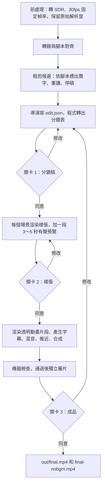

# Reels 剪輯工作流設計

- 日期：2026-11-11
- 狀態：待審閱
- 依據：`docs/research/2026-11-11-claude-code-reels-research.md`（以下簡稱「研究報告」）、`docs/research/notes/`
- 第 1 期改版取代了部分內容，見 `docs/superpowers/specs/2026-11-12-phase1-revision-design.md` 第 10 節。

## 1. 目標

用 Claude Code 建立一套自己用的短影音剪輯流程，能做到：

- 依腳本把口播順剪（刪除口誤、NG 重講、過長停頓）。
- 上繁體中文字幕。
- 上效果：畫面推近、音效、背景音樂。
- 做簡單的 2D 動畫：動態文字和標題卡、資訊圖表和簡報畫面、疊在畫面上的強調特效。

第一版只建立工作流程，由 CLAUDE.md、skill、subagent 和本機腳本組成，不做獨立 app。

## 2. 已確認的決定

| 項目 | 決定 |
|---|---|
| 使用對象 | 自己用，不產品化；只支援 macOS（Apple M1、16 GB） |
| 授權立場 | 經營個人品牌，一律視為商業用途；第三方的東西都要能商業使用 |
| 素材 | 手機直拍 9:16 口播（每支附腳本檔）、B-roll、螢幕錄影 |
| 2D 動畫 | 動態文字和標題卡、資訊圖表和簡報畫面、強調特效；不做角色動畫 |
| 效果 | 畫面推近（punch-in）、音效、背景音樂；不做轉場和調色 |
| 輸出 | Claude 直接輸出 mp4，不匯出到剪輯軟體；交兩版（有和沒有背景音樂） |
| Claude 方案 | Max 5x |
| 素材配置 | 寫腳本時標註 B-roll 和螢幕錄影的位置，沒標的段落由導演補建議 |
| 風格 | 第一版用一套現成的乾淨風格，所有畫面從風格設定檔取值 |
| 場景來源 | 以場景範本為主，範本不夠用時才寫自訂場景 |
| 確認關卡 | 3 道：分鏡稿、樣張、成品 |
| 音樂和音效 | 你有授權的曲庫，加上 CC0 音效 |
| 整體做法 | 動畫片段另外渲染成透明影片，剪接、字幕、合成交給 ffmpeg；動畫渲染器預設 Remotion，候選 HyperFrames，依第 12 節實測定案 |
| 使用者介面 | 用中文對話，加上關卡審閱網頁、場景型錄網頁、寬鬆的腳本標註；使用者不用碰 JSON |

## 3. 範圍

**包含**：第 1 節列出的功能、第 6 節的使用者介面、第 11 節的第三方授權清冊。

**不包含**：角色動畫、轉場、調色、匯出剪輯軟體專案、時間軸式的視覺化編輯器、自動發布到 IG、背景音樂卡拍、多種風格切換、Windows 支援、用 Claude Design 定義風格。

## 4. 架構

### 4.1 資料夾

產品程式和使用者資料分開放。使用者資料在 `studio/`，用 `.gitignore` 排除。資料夾名稱一律用英文。`studio/` 的位置由一個設定值決定。

```text
kacha/
├── CLAUDE.md                 主流程、三道關卡的規則、對話語言
├── THIRD_PARTY.md            程式庫、模型、字型的授權清冊
├── .claude/
│   ├── skills/               reel、storyboard、scene-catalog
│   └── agents/               scene-designer、reviewer
├── pipeline/                 Python：前處理、轉錄對齊、粗剪、字幕、混音、合成、檢查
├── scenes/                   場景卡專案（配方卡加實作；預設 Remotion，實測後定案）
├── styles/default/           風格設定檔和字型檔
├── tests/
└── studio/                   使用者資料（不進 git）
    ├── inbox/                放素材：口播、腳本、B-roll、螢幕錄影
    ├── library/
    │   ├── music/            授權曲庫
    │   ├── sfx/              CC0 音效
    │   └── ledger.json       音樂和音效的授權登記
    ├── brand/                brand.json（品牌名、IG 帳號、主色，可留空）、preferences.md
    └── projects/<日期-代稱>/  每支影片一個資料夾
```

每個專案資料夾的內容：

```text
projects/2026-11-12-coffee/
├── state.json                走到哪一關、每一步輸入檔的雜湊值
├── project.md                導演的決定和你給過的意見（換新對話時接續用）
├── work/                     前處理影片、transcript.json、trim.json、assets.json、edit.json、場景片段、字幕檔
├── review/                   三道關卡的審閱網頁和素材
└── out/                      final.mp4、final-nobgm.mp4
```

### 4.2 流程



前處理、轉錄、粗剪候選、渲染、合成、機器檢查都是固定程式，不花 Claude 用量。Claude 只負責寫 `edit.json`、看樣張和審片拼圖，以及和你對話。

## 5. Claude Code 的組織方式

### 5.1 角色對應

| 角色 | 由誰承擔 | 模型 |
|---|---|---|
| 導演 | 主對話，由 `reel` skill 帶著走；寫 `edit.json`，主持三道關卡 | Opus 5.5 |
| 美術 | 風格設定檔和場景卡；需要自訂場景時派 `scene-designer`，一個場景一個，可同時跑 | Sonnet 5.5 |
| 剪輯師 | `pipeline/` 的固定程式 | 不用模型 |
| 品管 | 先跑 `pipeline` 的機器檢查，通過後派 `reviewer` 獨立審片 | Sonnet 5.5 |

導演不做成 subagent，因為 subagent 跑到一半不能停下來和你對話，三道關卡都需要對話。

### 5.2 Skill 和 subagent

| 名稱 | 種類 | 內容 |
|---|---|---|
| `reel` | skill | 主流程：讀 `state.json` 決定下一步、三道關卡的規則、`pipeline` 指令用法。說「剪 inbox 裡的咖啡那支」或「繼續咖啡那支」就會觸發 |
| `storyboard` | skill | 寫 `edit.json` 的規則：剪多狠、B-roll 怎麼放、語意標籤怎麼選、推近和音效放哪裡 |
| `scene-catalog` | skill | 場景卡清單和參數、每個語意標籤對應的候選卡、寫自訂場景的規則 |
| `scene-designer` | subagent | 依風格設定檔寫一個自訂場景，通過冒煙測試後交回；導演決定要不要收進範本庫 |
| `reviewer` | subagent | 沒有製作過程的記憶，依審片清單看 3×4 拼圖，逐條回報問題、嚴重度和格數 |

### 5.3 其他決定

- **MCP**：第一版不接。Claude Code 本來就能直接執行 ffmpeg。
- **Hooks**：第一版不用。`edit.json` 的檢查放在每個 `pipeline` 指令的開頭。
- **偏好記憶**：你說「以後都…」時，導演寫進 `studio/brand/preferences.md`，每次開工先讀。不用 Claude 內建的 memory。
- **同時剪多支**：每支影片一個專案資料夾，開兩個 Claude 視窗各剪一支也不會互相干擾，不另外設計。
- **對話語言**：繁體中文。`pipeline` 指令的輸出用英文加 JSON，由 Claude 轉述成中文。

## 6. 使用者介面

使用者不用讀或改任何 JSON，只會接觸到以下四樣東西：

1. **中文對話**：例如「0:12 那邊的數字換成長條圖」「咖啡店畫面晚一秒進」。導演把時間或句子對應回 `edit.json`，改完重跑檢查。
2. **關卡審閱網頁**（本機 HTML，淺色）：
   - 關卡 1：分鏡表。每列一句字幕，附畫面縮圖、場景名稱、音效；剪掉的段落用刪除線標出並附試聽；吻合度低的句子標「請聽」。
   - 關卡 2：每個場景一張靜態樣張，加一段 3～5 秒有聲預覽。
   - 關卡 3：兩版成品，加審片報告。
3. **場景型錄網頁**：每張場景卡一張樣張或一段短預覽，可以直接說「第 5 句用這張」。樣張就是第 10 節冒煙測試的產物。
4. **寬鬆的腳本標註**：`[B-roll: 咖啡店]`、`【螢幕：設定步驟】`、單獨一行的「（這裡放咖啡店外觀）」都算。導演看不懂就在分鏡稿裡問。素材檔名不用照規則取。

## 7. 資料格式

### 7.1 檔案分工

| 檔案 | 由誰產生 | 內容 |
|---|---|---|
| `transcript.json` | 程式 | 每句的腳本原文、起訖時間、逐字時間戳、吻合度、`needs_listen` 標記 |
| `trim.json` | 程式 | 粗剪候選，每條有代號、種類（filler 贅字、repeat 重講、pause 停頓、retake NG 段）、起訖、理由、`needs_listen` |
| `assets.json` | 程式 | B-roll 和螢幕錄影：長度、方向、縮圖拼板路徑 |
| `edit.json` | 導演 | 唯一由 Claude 寫的檔案，見 7.2 |
| `storyboard.md` 和關卡 1 網頁 | 程式 | 由 `edit.json` 轉出 |

### 7.2 `edit.json`

```json
{
  "version": 1,
  "style": "default",
  "cuts":      { "accept": ["t01", "t02"], "reject": ["t07"],
                 "extra": [{ "from": "s05", "to": "s06", "reason": "離題" }] },
  "sentences": [{ "id": "s03", "sem": "number", "weight": "main" }],
  "scenes":    [{ "id": "sc2", "card": "number-slab", "layout": "overlay",
                  "at": { "s": "s03", "char": 4 }, "until": { "s": "s04", "end": true },
                  "params": { "value": "三倍", "label": "轉換率" } }],
  "broll":     [{ "asset": "coffee.mov", "in": 2.0, "layout": "full",
                  "at": { "s": "s07" }, "until": { "s": "s08", "end": true } }],
  "punch_in":  [{ "at_cut": "c4", "scale": 1.1 }],
  "sfx":       [{ "sound": "pop-soft", "on": { "scene": "sc2", "event": "enter" } }],
  "music":     { "track": "calm-01", "duck_db": -12 },
  "captions":  { "mode": "line" }
}
```

- **時間錨點**：位置一律寫成「句子代號加字的位置」，不寫秒數。`pipeline` 在套用剪接之後才換算成實際時間，所以剪接改了，場景和音效不用重排。
- **版面 `layout`**：
  - `full`：取代口播畫面。
  - `overlay`：透明動畫疊在口播或 B-roll 上。
  - `split`：螢幕錄影在上方，口播在下方。
- **字幕模式 `mode`**：`line` 整句一行，或 `word` 逐字高亮。

### 7.3 語意詞彙和場景卡

每句標一個語意標籤，從下表的固定詞彙中挑；`weight` 填 `main`（這句可以帶出新畫面元素）或 `sub`（陪襯句）。每個標籤對應幾張候選卡，導演從候選卡裡挑。

| 語意標籤 | 意思 | 候選場景卡 |
|---|---|---|
| `hook` | 開場鉤子 | `title-card`、`keyword-pop` |
| `claim` | 觀點、主張 | `keyword-pop`、`quote-card` |
| `number` | 數字、數據 | `number-slab`、`bar-chart` |
| `list` | 條列 | `bullet-list` |
| `compare` | 對比 | `versus-split`、`bar-chart` |
| `steps` | 步驟、流程 | `step-flow` |
| `example` | 舉例、示範 | `callout-arrow`、`highlight-box`（多用在 B-roll 和螢幕錄影上） |
| `quote` | 引言 | `quote-card` |
| `define` | 名詞解釋 | `term-card` |
| `warning` | 提醒、注意 | `keyword-pop`、`highlight-box` |
| `cta` | 號召（追蹤、留言） | `cta-card` |
| `aside` | 補充、過場 | `sticker-pop` 或不加畫面 |

第一版的場景卡共 13 張：`title-card`、`keyword-pop`、`number-slab`、`bar-chart`、`bullet-list`、`versus-split`、`step-flow`、`quote-card`、`term-card`、`callout-arrow`、`highlight-box`、`sticker-pop`、`cta-card`。每張卡是一份配方卡，寫明用途、參數、不得降檔的參數（時序、緩動、比例）、是否屬於大衝擊效果（`impact: true`），並附渲染器的實作原始碼。卡片顏色、字型、圓角一律從風格設定檔取值，卡片裡不得寫死。卡片版面一律避開風格設定檔定義的字幕帶。

### 7.4 `pipeline validate` 的規則

每個渲染指令開頭都會自動跑；違反任何一條就報錯，不往下做。

1. 格式正確；所有句子代號、字的位置、素材、粗剪候選代號都存在。
2. 同一時段最多一個 `full` 畫面。
3. 同一張場景卡不連用 3 次。
4. `full` 版面的場景加總不超過全片長度的 1/3。
5. 大衝擊效果（配方卡標記 `impact: true` 的場景，也就是整個畫面一起動的效果）全片最多 3 次；推近不算。
6. 音效和音樂的代號都在 `studio/library/ledger.json` 裡，而且標記為可商業使用。
7. 語意標籤都在 7.3 的詞彙表裡。

## 8. 處理細節

### 8.1 前處理

- 用 ffprobe 讀出解析度、幀率、`color_transfer`、旋轉資訊。HDR 素材轉成 SDR，變動幀率轉成 30fps 固定幀率，輸出工作檔到 `work/`。
- **工作檔保留原始解析度，不在前處理縮放**。例如 4K 素材的工作檔還是 4K，720p 就照原樣。縮放統一在合成時做一次（見 8.7），所以推近從原始畫面裁切，不會先縮小再放大。
- B-roll 和螢幕錄影一樣處理，並為每支素材產生縮圖拼板。

### 8.2 轉錄與對齊

- 語音辨識引擎由第 12 節的實測決定，候選有 Qwen3-ASR、Breeze-ASR-25、FireRedASR2-CTC。
- 辨識出的字和時間戳逐字對到腳本上。比對前先把繁簡統一並轉成無聲調拼音，所以同音字不算錯；英文詞夾在中文之間時，時間依前後的中文字內插。
- 字幕的字取自腳本，時間取自語音。和腳本對不上的句子（臨場改詞）改用辨識結果，經 OpenCC `s2twp` 轉成台灣用語，並標記 `needs_listen`。
- 每句吻合度低於 0.90 就標 `needs_listen`。

### 8.3 粗剪規則

以腳本為準，寧可少剪也不要剪錯：

- 只剪腳本裡沒有的段落：
  - 贅字：嗯、呃、欸、那個、就是，且腳本該處沒有這些字。
  - 重講：和相鄰腳本文字相同的重複段落。
  - NG 段：同一句腳本講了好幾次，只保留最後一次完整講完的。
- 辨識錯的腳本文字永遠不剪。
- 措辭和腳本不同的重講段落只列出來，不自動剪。
- 停頓超過 0.7 秒的壓到 0.35 秒，保留真實環境音，不補數位靜音。這兩個數字是初始值，實測後再調。
- 切點先找音量最低處，再對齊到 30fps 的格線。切點不在靜音裡的標 `needs_listen`。
- 剪接記錄要有原始時間和新時間的對照表，字幕、場景、音效都靠它換算時間，不重新轉錄。

做法參考 video-talkcraft 的公開文件，自行實作，不複製它的程式碼和文字。

### 8.4 字幕

- 產生 ASS 字幕檔，由 ffmpeg 燒進畫面。斷行在程式裡完成，不依賴 libass 的自動換行。
- 每行最多 16 字，最多 2 行，預設 1 行（參考 Netflix 繁中規範）。逐字高亮用 ASS 的 `\k` 標籤。
- 字幕位置在 Meta 廣告安全區內：上 14%、下 35%、左右各 6%，換算成 1080×1920 是 x 65～1015、y 269～1248。一般 Reels 沒有官方數字，暫用這組。同時要在臉部偵測框下方。每支影片固定一個位置，不隨畫面移動。
- 字幕全程顯示，包含 `full` 場景期間。字幕帶的位置寫在風格設定檔裡，場景卡的版面一律避開這個區域。

### 8.5 場景渲染

- 每個場景渲染成一段獨立影片：`overlay` 輸出帶透明通道，`full` 輸出不透明。透明格式（ProRes 4444 或 WebM VP9 alpha）由實測決定。
- 每個片段的快取鍵是「卡片原始碼、參數、風格設定、長度」的雜湊值；沒變就不重新渲染。
- 渲染要能逐格重現：不用 `Date.now()` 和 `Math.random()`，亂數一律用固定種子。
- 字型檔放在專案內，隨渲染一起打包；字幕和場景用到的每個字，渲染前都要確認字型裡有。
- 2026-11-15 起有第一批三張卡（重點字、數字卡、清單，都是 `overlay`），透明格式用 ProRes 4444，詳見 `docs/superpowers/specs/2026-11-15-remotion-foundation-design.md`。

### 8.6 推近、音效、音樂

- **推近**：放在同一個口播鏡頭的切點後。預設放大 1.1 倍，上限 1.2 倍，以臉部偵測框中心為錨點；相鄰兩次推近不用同一個倍數。2026-11-15 起改成預設不推近，只在使用者指定的地方放大，詳見 `docs/superpowers/specs/2026-11-15-punch-in-design.md`。
- **音效**：只能用 `ledger.json` 裡登記過的 CC0 音效，掛在場景事件上（進場、強調、退場）。
- **背景音樂**：人聲出現時自動壓低 `duck_db` 分貝。加了音樂之後，整體響度仍是 -14 LUFS、真峰值 -1 dBTP。這是業界慣例，不是 Meta 的官方規定。人聲本身的處理第 1 期已經做了（見 8.7 節「聲音」）；做法照那裡，一個增益加限幅器，不用 loudnorm 的動態模式。
- **兩版輸出**：`final.mp4` 含背景音樂；`final-nobgm.mp4` 只有人聲和音效，方便你在 IG App 裡另外配樂。

### 8.7 輸出規格

1080×1920、30fps 固定幀率、H.264、yuv420p、AAC 48 kHz 立體聲 128 kbps 以上，位元率低於 25 Mbps，檔案小於 300 MB。編碼器用 libx264 或 h264_videotoolbox，由實測決定。

IG 官方只要求長寬比在 1.91:1 到 9:16 之間、至少 30fps、至少 720 px（Instagram 說明中心）。1080×1920 是我們自己選的：每個圖層共用同一套座標，動畫也不用渲染到 4K 的像素量。

合成的順序：每個來源先依推近或版面需要，從原始解析度的工作檔裁切，再縮到目標尺寸，然後疊上動畫和字幕。整條流程裡，每個來源只縮放一次。

**聲音**（2026-11-14 加進第 1 期）：剪好的人聲先經過固定的處理，再編碼成 AAC。

- 處理的順序：切掉 80 Hz 以下；用 ffmpeg 的 `afftdn` 降噪（降 12 dB，噪音門檻 -35 dB）；250 Hz 附近減 2 dB；2.5 kHz 以上加 3 dB。
- 這組設定是使用者聽了七個版本選的。素材是一支真實的手機錄音：整體響度 -25.6 LUFS，嘴巴離麥克風太遠，有穩定的室內雜音，集中在 1 kHz 以下。只降噪的版本聽起來偏悶，因為降噪也拿走了 2.5 kHz 以上約 2 dB 的人聲，所以補回高音；雜音在那裡幾乎沒有，補高音不會把雜音帶回來。
- 響度：整支用同一個增益拉到 -14 LUFS，再用限幅器把取樣峰值壓在 -1.5 dB，編碼後的真峰值才會在 -1 dBTP 以內。限幅器會吃掉一點響度，所以寫完再量一次，把差的補進增益，最多寫三次。不用 loudnorm：音量差這麼多時，它會改用動態模式，把停頓拉得比講話多，雜音跟著變大，等於抵消了降噪。
- `afftdn` 會讓聲音晚 25 毫秒、吃掉最後 25 毫秒，處理時補回來，聲音和畫面對齊。
- 輸出的程式改了聲音處理，`render` 這一步的版本號跟著變，已經輸出過的專案下次 `render` 會重新輸出，不會跳過。

## 9. 品管

**第一層：機器檢查**（`pipeline check`），全部通過才進第二層：

- 黑畫面（ffmpeg `blackdetect`）。
- 字幕框和臉部偵測框有沒有重疊、字幕是否在安全區內。
- 每個音效出現時，該時間窗的音量確實有變大。
- 響度和真峰值是否在目標範圍內。
- 兩版成品的長度和幀數一致。

**第二層：獨立審片**：

- 抽格範圍：每句 1 格、每個切點的前後各 1 格、每個場景進場和定格各 1 格，拼成 3×4 拼圖交給 `reviewer`。
- `reviewer` 拿到的資料：分鏡表、`edit.json`、風格設定檔、審片清單、拼圖。製作過程的對話不給它。
- 回報分三級：P0 必修（字錯、遮臉、畫面壞掉）、P1 應修、P2 可再想。
- 審一輪，修完 P0 和 P1 就交件；你要求的話可以再審，累計最多 3 輪。

## 10. 錯誤處理和驗證

### 10.1 錯誤處理

- **可以接著做**：`state.json` 記錄每一步完成的時間和輸入檔的雜湊值，重跑時輸入沒變就跳過。
- **換新對話不失憶**：對話快接近 context 上限時，導演先把目前的決定和你給過的意見寫進 `project.md`，再換新對話。
- **渲染前先擋**：HDR 和變動幀率在前處理就處理掉；缺字、沒登記的音樂或音效、`validate` 不通過，都在渲染前報錯。
- **渲染失敗**：自動重試一次，還失敗就回報錯誤訊息和 log 位置。
- **保護原始素材**：`inbox/` 只讀不寫。刪除只發生在專案資料夾內，遞迴刪除一律經過安全刪除函式，它會拒絕空路徑、相對路徑、`/`、家目錄及其上層目錄。這個函式的測試要涵蓋上述每一種情況。

### 10.2 驗證

1. **單元測試**（先寫失敗的測試，再寫程式）：涵蓋腳本和語音的對齊、贅字和重講和停頓的判斷、錨點換算時間、字幕斷行、ASS 產生、`validate` 的每條規則、安全刪除。
   - 測試素材用 macOS 內建的中文語音照固定腳本合成，故意加入重講和停頓，正確答案是已知的。
   - 實作前先確認 `say -v Meijia` 這個語音可用，不能用就改成自己錄一段固定腳本。
2. **場景卡冒煙測試**：每張卡用範例參數渲染一張樣張，確認不會出錯，樣張同時拿來做場景型錄。
3. **驗收**：見第 14 節。

## 11. 授權

- **商業使用原則**：第三方的程式庫、模型、字型、音樂、音效都必須能商業使用。
- **兩份清冊**：
  - `THIRD_PARTY.md`：程式庫、模型、字型，每項記錄名稱、版本或來源、授權、能否商業使用、用途、查核日期。
  - `studio/library/ledger.json`：音樂和音效，`validate` 會讀這份。
- **已知狀況**：
  - Remotion：研究報告的結論是個人和 3 人以下的公司免費，包含商業用途。但有一個二手來源說它是 BUSL 授權，和官方 LICENSE.md 矛盾，所以實測時要再對一次官方 LICENSE.md，結果記進 `THIRD_PARTY.md`。
  - video-shotcraft 是 Apache-2.0，要改用它的程式碼時，保留 LICENSE 並標明修改處。
  - video-talkcraft 是 PolyForm Noncommercial，只參考公開文件的做法，不安裝、不執行，也不複製它的程式碼、卡片和文字。
  - Noto Sans TC 是 OFL 授權。
  - 語音辨識模型的授權在實測時確認。

## 12. 實作第一步：在 M1 上實測

需要準備：你的一支真實口播素材和它的腳本。

| 實測項目 | 量什麼 | 怎麼選 |
|---|---|---|
| 語音辨識：Qwen3-ASR（MLX 移植版）、Breeze-ASR-25（MLX 版）、FireRedASR2-CTC（sherpa-onnx） | 對腳本的字錯誤率、時間戳誤差（抽 20 個字，人工對波形確認）、速度、記憶體峰值、授權 | 先剔除不能商業使用的；再比時間戳準度；速度要放得進時間預算 |
| 渲染器：Remotion 和 HyperFrames | 5 秒、1080×1920、透明背景、含繁中字的動畫：渲染時間、透明通道在 ffmpeg 疊圖後是否正確、中文字是否正常 | 透明通道和中文字都必須正確，再比速度 |
| ffmpeg | 有沒有 libass；60 秒影片用 libx264 和 h264_videotoolbox 各編碼多久、畫質差多少；4K HDR 素材轉成 SDR 工作檔要多久、檔案多大 | 時間和畫質一起看；4K 工作檔太慢或太大的話，改成縮到 1.25 倍輸出尺寸（1350×2400），推近上限 1.2 倍仍不用放大 |
| 測試語音 | `say -v Meijia` 能不能用 | 不能用就改成自己錄 |

**時間預算**：15 分鐘裡，機器運算的目標是 6 分鐘內，其餘留給三道關卡的審閱。實測後依實際數字調整。

實測結果寫成 `docs/spikes/` 裡的一份紀錄。第 2、4、7、8 節裡「由實測決定」的項目，照這份紀錄定案：渲染器、語音辨識引擎、透明影片格式、編碼器。

## 13. 實作分期

每一期各寫一份實作計畫，做完、驗證過再進下一期。

| 期別 | 內容 | 這一期的成果 |
|---|---|---|
| 0 | 第 12 節的實測 | 實測紀錄，各項選型定案 |
| 1 | `CLAUDE.md`、`reel` 和 `storyboard` skill、前處理、轉錄對齊、粗剪、`edit.json`（剪接、語意標籤、字幕）、`validate`、ASS 字幕、人聲處理（降噪、等化、響度）、合成輸出、關卡 1 網頁、`state.json`、安全刪除、`THIRD_PARTY.md` | 有字幕的順剪 mp4 |
| 2 | 風格設定檔、13 張場景卡、場景渲染和快取、B-roll、螢幕錄影和 `split` 版面、推近、關卡 2 網頁、場景型錄、`scene-catalog` skill、`scene-designer` | 加上動畫和 B-roll 的 mp4 |
| 3 | 音效、背景音樂、人聲時壓低音樂、加了音樂之後的整體響度、兩版輸出、`ledger.json`、機器檢查、`reviewer`、關卡 3 網頁 | 完整成品，接著做第 14 節的驗收 |

## 14. 驗收標準

用你自己的一支真實素材（成品 60 秒左右）完整跑一次：

1. 從素材放進 `inbox/` 到拿到兩版 mp4，計時 15 分鐘內，包含三道關卡的審閱時間。
2. 字幕 0 錯字。
3. 成品不用再開剪輯軟體修就能發布。
4. 第三方授權清冊完整，沒有不能商業使用的項目。

## 15. 參考資料

- 研究報告和筆記：`docs/research/`。
- video-shotcraft：https://github.com/Vincentwei1021/video-shotcraft （Apache-2.0）。
- video-talkcraft：https://github.com/Vincentwei1021/video-talkcraft （PolyForm Noncommercial，只參考做法）。
- browser-use/video-use：https://github.com/browser-use/video-use （MIT）。
