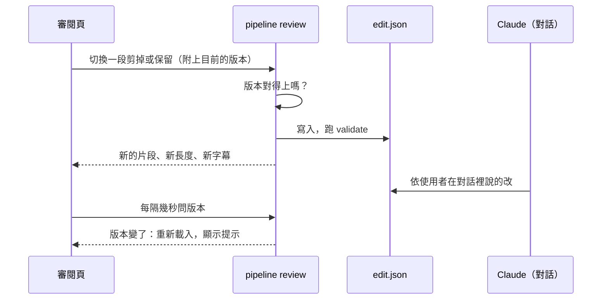

# 互動審閱頁設計

- 日期：2026-11-12
- 狀態：待審閱
- 依據：
  - 第 1 期改版的實測（同一支驗收素材）之後，使用者對關卡 1 的回饋：審閱方式不夠好上手，而且同意前看不到剪完的樣子；
  - 同一天在 iPhone 上做的播放測試（第 9 節）。
- 前面的設計：
  - 原設計 `docs/superpowers/specs/2026-11-11-reels-workflow-design.md`；
  - 第 1 期改版 `docs/superpowers/specs/2026-11-12-phase1-revision-design.md`（以下簡稱「改版」）。本文件改動改版第 6 節的關卡 1 流程，改動的部分見第 13 節。

## 1. 目標

改版之後的關卡 1 是一則中文訊息，加一份靜態網頁（摘要、兩個清單、句子表、候選表）。使用者指出四個問題，都成立：

- 網頁太像資料表：看得到 `s01`、`t01` 這類代號，和英文的原因（`pause 0.80s -> 0.37s`）；
- 要在訊息和網頁之間對照編號和時間；
- 只能聽一段一段的試聽片段，同意之前看不到整支剪完的樣子；
- 在手機上要下載一個 HTML 檔才能看，而且在 iPhone 上試聽片段播不出聲音（第 9 節）。

這次做一個在電腦上用的互動審閱頁：影片照剪完的樣子播，一邊看一邊切換剪掉或保留，影片馬上照新的決定播；字幕的字也能在頁面上直接改。看完在頁面上按同意，頁面直接輸出成品。

成功的樣子：

- 不讀表格、不看代號，就能看完剪好的樣子、改完要改的決定、按同意拿到成品；
- 切換一段剪掉或保留之後，不用重新輸出，影片就照新的決定播；
- 字幕的錯字在頁面上就能改掉，不用改腳本檔再從轉錄重跑；
- 想用講的，隨時可以回到對話跟 Claude 說，兩邊看到的是同一份決定。

## 2. 名詞

- **審閱頁**：這次新做的互動網頁，由 `pipeline review` 啟動的小程式提供，只在跑 `pipeline` 的那台電腦上用。
- **審閱用影片**：從原始影片轉出的一支低畫質影片，整支沒有剪過，只給審閱頁播。
- **跳段播放**：審閱頁播審閱用影片時，播到剪掉的段落就直接跳到下一段留下的地方。
- **靜態網頁**：改版做的 `review/gate1/index.html`，單一檔案，不用小程式就能開。這次保留它，給不在電腦前的時候用。
- **註記（`notes`）**：Claude 寫在 `edit.json` 裡、給某一項的一句說明，格式是「建議…。因為…」。
- **字幕改字**：使用者或 Claude 把某一句字幕的字改成別的字，記在 `edit.json` 的 `captions.text`。

## 3. 已確認的決定

| 項目 | 決定 |
|---|---|
| 用的人 | 會用 Claude Code 的人。頁面要不用讀說明就能操作；想用講的，隨時可以回對話 |
| 在哪裡看 | 電腦上的瀏覽器 |
| 版面 | 左邊影片，右邊整支的逐字稿 |
| 建議和理由放哪裡 | 點了才說明：點逐字稿上的標記，旁邊浮出小卡；上方的導覽條一項一項帶過去 |
| 理由的寫法 | 一律「建議…。因為…」 |
| 能改什麼 | 程式找到的段落（剪掉或保留）、拿掉整句、改字幕的字。不能自己選任意一段字剪掉 |
| 同意按鈕 | 隨時可以按；按了先跳確認框，列出沒點開看過的項目和會留在成品裡的錯字 |
| 同意之後 | 頁面直接重做分鏡稿、記下同意、輸出成品，完成後在頁面上播 |
| 不在電腦前 | 保留靜態網頁，修好它在 iPhone 上的播放 |
| 怎麼做到邊看邊改 | 跳段播放（第 5.3 節），不重新輸出 |

## 4. 階段

分兩個階段實作，第 1 階段做完就能用：

1. **互動審閱頁**：第 5、6、8、9、10 節。
2. **在頁面上改字幕的字**：第 7 節。

以後再做（這次不設計）：在逐字稿上自己選任意一段字剪掉。

## 5. 組成和資料流

### 5.1 `pipeline review <專案>`

- 新指令。啟動一個只在本機跑的小程式（只接受 `127.0.0.1` 的連線），用預設瀏覽器打開審閱頁，結果照 `pipeline` 的慣例印一行 JSON（有審閱頁的網址）。
- 網址帶一組隨機通行碼；沒有通行碼的請求一律拒絕。第一次開啟後，瀏覽器用 cookie 記住通行碼。
- 連接埠自動挑一個沒被占用的。
- 只用 Python 標準函式庫，不加新套件。
- 啟動的條件：`edit.json` 已經通過 `validate`，而且之後 `edit.json`、`transcript.json`、`trim.json` 都沒變（和 `storyboard` 的條件相同）。不符合就拒絕，訊息照第 10 節。
- 結束：頁面停止詢問超過 30 分鐘（頁面關掉了），或 Claude 依使用者的要求停掉它。輸出中不結束。關卡 1 的時候由 Claude 在背景啟動。

### 5.2 審閱用影片

- `review` 第一次執行時，從原始影片轉出 `work/review.mp4`，之後輸入沒變就跳過（照 `run_step` 的慣例）。
- 畫面和聲音的來源和成品相同，時間才對得上：
  - 畫面用輸出成品時用的那一支（HDR 的影片用 `prep` 轉好的 `work/video.mp4`，其他用原始影片），照成品一樣裁成 9:16；
  - 聲音用 `work/audio48k.wav`。它從第一格畫面開始，所以審閱用影片上的時間就是逐字稿和 `trim.json` 上的時間。
- 規格：540×960、30 fps、H.264，關鍵畫格間隔短（例如 0.5 秒），聲音轉成 AAC。實際數字在第 11 節的小實驗後定。
- 小程式提供這支影片時要支援分段讀取（HTTP Range），瀏覽器才能快速跳到任何時間點。

### 5.3 跳段播放

- 小程式用 `edit.py` 現有的方法算出留下的片段（原始時間軸上的範圍），連同字幕的每一行（原始時間軸上的出現、消失時間）一起交給頁面。
- 頁面播放時，目前時間落進剪掉的範圍，就跳到下一個留下的片段開頭。
- 頁面上顯示的時間一律換算成成品裡的時間，和靜態網頁、`storyboard.md` 一致。
- 字幕由頁面疊在影片上，斷行用和成品同一份結果，字型用同一個 Noto Sans TC 靜態字型（由小程式提供）。
- 跳得準不準、接點有沒有爆音，第 11 節的小實驗先量。量出來不夠好，回來和使用者討論要不要加「輸出真的預覽」按鈕（輸出一支真的預覽，在頁面上播）；這份設計不包含這個按鈕。

### 5.4 改決定

- 頁面的每個改動（切換剪掉或保留、拿掉或復原一句、改字幕）送給小程式，小程式改 `edit.json`、馬上跑 `validate`。
  - 通過：存檔，回傳新的片段、新長度和受影響的字幕行。
  - 不通過：不存，回傳原因，頁面用中文顯示。
- **版本**：`edit.json`、`transcript.json` 和 `trim.json` 三個檔案各自的雜湊值，合起來再算一次的雜湊值（少了的檔案以固定的方式算進去，見 `review_data.edit_version`）。`transcribe` 或 `trim` 重跑之後，即使 `edit.json` 一個字沒變，版本也會變，因為裡面的代號可能指向別的句子或候選。頁面送出改動時附上它看到的版本；和現在的版本不同（例如 Claude 剛在對話裡改過），就不套用，頁面先重新載入再讓使用者改。頁面每隔幾秒問一次版本，變了就重新載入，並顯示一行提示（例如「Claude 改了 1:43 那段的處理」）。
- 拿掉一句時，小程式：
  - 在 `cuts.extra` 加一筆，`from` 和 `to` 都是那一句，`reason` 是「在審閱頁拿掉」；
  - 把那一句在 `sentences` 的那一筆拿掉；
  - 那一句之前、屬於它的腳本外的話和改詞重講，還在成品裡的，一併接受（剪掉），和 `reel` skill 現在的做法相同；
  - 把拿掉的那一筆（語意標籤和輕重）和改成剪掉的候選，記在 `work/review-undo.json`，給復原用。記錄附上當時 `transcript.json` 和 `trim.json` 的雜湊值；這兩個檔案之後變了，代號可能指向別的內容，記錄就不用。
- 復原時，小程式拿掉那一筆 `cuts.extra`，範圍裡的每一句加回 `sentences`：
  - 語意標籤和輕重用 `work/review-undo.json` 記的；沒有記錄的（例如 Claude 拿掉的句子）用 `claim` 和 `main`，和 `storyboard` skill「拿不準時用 `claim`」一致。第 1 期的成品不用這兩個值，它們只出現在分鏡稿的句子表；
  - 記錄裡的候選，現在仍是剪掉的，改回拿掉之前的處理；
  - 一筆 `cuts.extra` 包含好幾句（例如 Claude 把離題的兩句一起拿掉）時，復原的是整筆。
- 小程式寫 `edit.json` 一律先寫暫存檔再換名，不會留下寫到一半的檔案。

### 5.5 同意之後

1. 頁面的確認框按「確定」，送出時附上頁面看到的版本。小程式依序：
   1. 版本和現在的版本不同，就不輸出，頁面重新載入（版本和做法都和第 5.4 節相同）；
   2. 檢查磁碟可用空間，低於 15 GB（`doctor` 用的同一個門檻）就停下來，頁面提醒先清出空間；
   3. 重做分鏡稿（靜態網頁和 `storyboard.md` 一起更新）；
   4. 記下關卡 1 的同意（和 `pipeline approve` 相同）；
   5. 輸出成品和手機預覽版（和 `pipeline render` 相同）。
2. 頁面顯示每一步的進度。這段時間不能改決定。
3. 完成後頁面播手機預覽版，並寫出 `out/final.mp4` 和 `out/preview.mp4` 的位置，有「打開所在的資料夾」按鈕。
4. 使用者在對話裡回「可以」、由 Claude 跑 `approve` 和 `render` 時，小程式從專案的狀態看出已經同意，頁面顯示「已經在對話裡同意了。輸出的進度請看對話；輸出完成後，這裡會播預覽版。」，也不能改決定。頁面看不出輸出是否正在進行（Claude 可能因為磁碟空間停下來，輸出也可能失敗），所以不說「正在輸出」。輸出完成後和第 3 步相同。

## 6. 頁面

用第 1 期驗收素材的長度和項目舉例；句子是編的。

### 6.1 版面

- **最上面一列**：專案名稱、原長和新長、剪掉幾段、「同意，輸出成品」按鈕。
- **導覽條**：
  - 「要你決定 N 項（還沒看 M 項）」，加上一項、下一項；
  - 「建議聽一下 N 處」「字幕可能有錯字 N 句」，點了也是一處一處跳過去。
  - 跳到一項：影片停在那一項前面一點，逐字稿捲到那裡，浮出那一項的小卡。
- **左邊**：影片（9:16）、播放鍵、成品裡的時間、0.5 倍速、整支的時間軸（留下、剪掉、要你決定三種顏色）。
- **右邊**：整支的逐字稿，每句前面標在成品裡的時間。點任何一個字，影片從那裡播。正在播的那句底色亮起來。
- **最下面一行**：標記的說明，和「想用講的：回到 Claude 對話說『1:15 那段保留』也可以」。

### 6.2 逐字稿上的標記

| 標記 | 意思 | 點了 |
|---|---|---|
| 紅色刪除線 | 剪掉的贅字、重複、口誤、腳本外的話 | 浮出小卡；小卡上切換剪掉或保留 |
| 「停頓 0.8→0.4 秒」小標籤 | 剪短的停頓 | 同上 |
| 橘框加編號 | 要你決定的項目 | 同上 |
| 虛線底線 | 剪接處不在靜音裡，可能切到字 | 同上，小卡上有「播這一段前後」 |
| 紫底 | 字幕用辨識出來的字，可能有錯字 | 浮出錯字小卡（第 6.3 節） |
| 灰字加「沒講到，不出字幕」 | 腳本有、講者沒講的句子 | 沒有動作 |
| 灰字刪除線加「拿掉了這一句　復原」 | 拿掉的整句（在頁面上拿掉的，或 Claude 拿掉的；Claude 拿掉的另外顯示原因） | 「復原」把它加回來（第 5.4 節） |

每句句尾的「⋯」選單：拿掉這一句、從這裡播放；第 2 階段加「改字幕」。

### 6.3 小卡

- 標題：編號（要你決定的才有）、在成品裡的時間、種類、講了什麼。
- 說明：一律「建議…。因為…」。
  - 有 Claude 寫的註記，就用它。
  - 沒有的（停頓、贅字、重複這類），頁面依種類產生，例如「建議剪掉。因為這是 0.8 秒的停頓，剪成 0.4 秒。」
- 按鈕：「剪掉」「保留」（建議的那個標「（建議）」，選中的用填滿的顏色表示，不另外加勾）、「播這一段前後」。
- 錯字小卡：講了什麼、腳本是什麼、建議；按鈕是「拿掉這一句」「保留（錯字會留在成品裡）」「播這一句」，下面一行「要改字或重錄：回到 Claude 對話說『1:48 那句我要改』。」第 2 階段加「改字幕」按鈕，那一行改成只講重錄。

### 6.4 確認框

- 新長和剪掉幾段。
- 沒點開看過的要你決定的項目，逐項列出會怎麼處理（例如「1:43『但我覺得如實嗯』剪掉」）。
- 字幕照辨識的字出、沒改過的句子，逐句說「錯字會留在成品裡」。
- 按鈕：「回去再看看」「確定，輸出成品」。

### 6.5 文字規則

- 頁面上不出現 `s01`、`t01` 這類代號，也不出現英文的原因；種類用中文名稱（停頓、贅字、重複、NG、改詞重講、腳本外的話）。
- 時間一律是成品裡的時間（m:ss.s）。
- 頁面固定用淺色。

## 7. 在頁面上改字幕的字（第 2 階段）

### 7.1 操作

- 任何一句都能改：錯字小卡的「改字幕」，或句尾「⋯」選單的「改字幕」。
- 改的時候，那一句展開成編輯框：
  - 上面：講了什麼（辨識的結果），只能看；
  - 下面：字幕要顯示的字，改過的字標綠色；
  - 打字時即時顯示會斷成哪幾行，左邊影片的字幕也跟著變；
  - 按鈕：「儲存」「取消」「復原成原本的字」「播這一句」。
- 存好之後，那一句標「已改字幕　復原」。它原本是「字幕可能有錯字」的項目，就從導覽條和確認框裡拿掉。
- 錯字小卡的建議寫具體的改法，例如「建議把『多成』改成『多撐』。因為讀音相同，應該是辨識錯的字。」

### 7.2 資料

- `edit.json` 的 `captions` 多一個鍵 `text`：句子代號對到字幕要顯示的字，例如 `{"mode": "line", "text": {"s12": "大概多撐兩小時吧"}}`。
- `validate` 檢查：
  - 代號是講者有講的句子；
  - 字不是空的（去掉空白後），也沒有換行。
- 被拿掉的句子，改過的字留著不用，復原時照舊顯示。
- 字型畫不出來的字，小程式存之前就擋下，說明是哪個字（輸出時的檢查照舊）。
- 字幕出現的時間：把改過的字和原本的字（`transcript.json` 裡那一句的字幕文字）逐字對照，原本每個辨識單位對到的字，換成它在新字裡對到的那幾個字，時間不變；新加的字併進前一個單位（句首的併進後一個）；整個單位的字都刪掉時，那個單位不再對到任何字。斷行照改版第 4 節的規則。
- 用到 `captions.text` 的地方：分鏡稿（兩個網頁、`storyboard.md`）、成品的字幕、審閱頁。
- Claude 在對話裡也用同一個鍵改字幕（使用者說「1:48 那句字幕改成…」）。改腳本檔、從轉錄重跑的做法照舊可以用。

## 8. Claude 的角色和規則

### 8.1 關卡 1 的訊息

- 使用者在電腦前：Claude 啟動 `pipeline review`，傳一則短訊息，例如「審閱頁開好了（網址）。4:00 剪到 3:37，有 2 項要你決定，字幕沒有看出錯字。在頁面上看完按同意就好；想用講的，也可以直接在這裡說。」
- 使用者用 Remote Control、不在電腦前：照改版的做法，傳靜態網頁和那則較長的訊息，使用者在對話裡回「可以」或要改的項目。

### 8.2 註記

- `edit.json` 多一個頂層的鍵 `notes`：代號（粗剪候選或句子）對到一句說明。可以省略。
- `validate` 檢查：
  - 代號是 `trim.json` 裡的候選，或講者有講的句子；
  - 說明以「建議」開頭，而且有「。因為」。
- Claude 寫 `edit.json` 時，每一項要你決定的候選、每一句字幕用辨識文字的句子，都要寫註記（寫在 `storyboard` skill）。`validate` 不強制每一項都要有：頁面上一切換，要你決定的項目可能變多，強制會讓切換失敗。沒有註記的，頁面依種類產生說明。
- 靜態網頁的清單也顯示註記。

### 8.3 規則的改動

- `edit.json` 由 Claude 和審閱頁的小程式寫，兩者寫完都要通過 `validate`。其他資料檔照舊只由 `pipeline` 產生。
- 關卡 1 的同意有兩種，都算明確的同意：
  - 使用者在對話裡明確回「可以」（照舊）；
  - 使用者在審閱頁的確認框按「確定」。
  - 同意的是按下去或回覆當時的那份分鏡稿；之後有任何改動，照舊要重新同意。
  - 使用者開著審閱頁時，他看到的分鏡稿就是頁面當時的樣子（頁面一直顯示目前的 `edit.json`）。他在對話裡回「可以」，Claude 跑 `storyboard`、`approve`、`render`，不再問；Claude 在他回覆之後又改了 `edit.json`，就要再問。
- 使用者在頁面上同意過，Claude 不在對話裡再問一次。
- 使用者回到對話時，Claude 先用 `pipeline status` 看專案走到哪一步，再讀 `edit.json`，用句子的內容和時間說，不講代號。

## 9. 手機用的靜態網頁

### 9.1 iPhone 播放測試（2026-11-12）

在 iPhone 上，從對話裡收到的檔案直接打開，做了三次測試：

| 方法 | 結果 |
|---|---|
| 網頁程式能不能執行 | 能 |
| `<audio>` 直接嵌入：M4A（目錄資訊在檔尾或檔頭）、MP3、WAV | 都顯示「錯誤」 |
| `<video>` 直接嵌入 M4A | 不能播 |
| 程式把聲音轉成暫存檔（Blob URL）交給 `<audio>` | 錯誤，代碼 4 |
| 程式用 Web Audio 自己解碼發聲（M4A、WAV） | 解碼成功；靜音模式開著時沒有聲音，關掉後有聲音 |
| 同上，先設 `navigator.audioSession.type = "playback"` | 靜音模式開著時一樣沒有聲音 |

結論：這個預覽畫面擋掉網頁裡的播放器，但讓網頁程式自己發聲；靜音模式會讓它沒聲音。

### 9.2 改動

- 試聽片段改由網頁程式解碼發聲（Web Audio），不再用 `<audio>`。聲音資料照舊嵌在檔案裡。
- 每個播放鍵旁邊加一行提示：「沒有聲音的話，請關掉靜音模式」。
- 清單顯示註記（第 8.2 節）和改過的字幕（第 7.2 節）。
- 其他照改版第 6.4 節。
- 改版後實測（2026-11-13）：在 iPhone 上從對話裡打開改版後的靜態網頁，關掉靜音模式，按兩個播放鍵都有聲音。

## 10. 出錯時

| 狀況 | 怎麼處理 |
|---|---|
| `review` 啟動時 `edit.json` 沒通過 `validate`，或之後檔案變了 | 拒絕，訊息和 `storyboard` 相同，`reel` skill 照現在的做法處理 |
| 審閱用影片轉檔失敗 | 拒絕，附記錄檔的位置 |
| 連接埠被占用 | 自動換一個 |
| 頁面開著，小程式停了 | 頁面顯示「審閱頁的程式已經停了，請回對話請 Claude 重新打開」；存進 `edit.json` 的決定不會不見 |
| 一個改動過不了 `validate` | 不存，頁面用中文說明原因 |
| 版本對不上 | 不套用，頁面重新載入，提示「決定剛被更新過，請再看一次」 |
| 按確定時磁碟可用空間低於 15 GB | 不輸出，頁面提醒先清出空間 |
| 輸出失敗 | 照現在自動重試一次；還失敗，頁面說明，請使用者回對話讓 Claude 看記錄檔 |

## 11. 實作前的小實驗

用第 1 期驗收的素材（在隔離的資料夾裡，只讀原檔）轉出審閱用影片，做一個只有影片和跳段播放的測試頁，在 Chrome 和 Safari 上量：

- 每次跳段時，畫面實際跳走的時間點和片段結尾差多少。目標：誤差在 1 格畫面（約 0.033 秒）以內。
- 用 `timeupdate` 和 `requestVideoFrameCallback` 兩種方法各量一次，選準的那個。
- 接點有沒有爆音或停頓：請使用者一起聽 5 個接點。
- 審閱用影片的轉檔時間和檔案大小。

結果寫回本文件，決定第 5.2 節的影片規格，以及要不要加「輸出真的預覽」按鈕。

### 11.1 結果（2026-11-13）

- 量的是第 1 期驗收素材的 18 個接點，在 Chrome 154 上各用一種方法量一次。表裡「多露出」是跳走前多播了幾格剪掉的畫面，「落點差」是跳過去的位置和下一段開頭差多少，「停住」是接點上畫面停住的時間。

  | 方法 | 多露出 | 落點差 | 停住（中位數／最長） |
  |---|---|---|---|
  | `requestVideoFrameCallback` | 最多 1 格（7 個接點 1 格，其餘 0 格） | 0 毫秒 | 16／83 毫秒 |
  | `timeupdate` | 每個接點 2 到 7 格 | 0 毫秒 | 24／76 毫秒 |

- 選 `requestVideoFrameCallback`，瀏覽器不支援時才用 `timeupdate`。實作再多提早一格判斷要不要跳，多露出的格數預期會更少，這一點沒有另外量。
- 使用者在 Chrome 上聽過接點，沒有特別不順的地方。
- Safari 沒有量。
- 審閱用影片：540×960、30 fps、H.264 1.5 Mbit/s、每 0.5 秒至少一個關鍵畫格、AAC 96 kbit/s。4:00 的素材轉出約 48 MB，轉檔 33 秒。
- 決定：第 5.2 節照上面的規格；不加「輸出真的預覽」按鈕。

## 12. 測試和驗證

- pytest：
  - `review` 小程式：
    - 沒有通行碼的請求被拒絕；讀資料；
    - 切換剪掉或保留之後 `edit.json` 改了而且通過 `validate`；過不了 `validate` 的改動不存；版本對不上不套用；
    - 拿掉一句（連同它前面的腳本外的話）和復原：照記錄還原；沒有記錄時用 `claim` 和 `main`；`transcript.json` 變了之後不用舊記錄；Claude 拿掉的整段一起復原；
    - 同意之後的流程（輸出用替身）：版本對不上不輸出；磁碟空間不足時不輸出；輸出中不能改決定；
    - 在對話裡同意之後，頁面看得出已經同意；
  - 分段讀取（HTTP Range）回傳正確的位元組；
  - `notes` 和 `captions.text` 的檢查；
  - 改字幕之後的單位對照（換字、加字、刪字、整個單位刪掉、句首加字），和分鏡稿、成品字幕用到改過的字；
  - 靜態網頁沒有 `<audio>`，有靜音提示，顯示註記。
- 手動：
  - 在 Chrome 上用驗收素材實際操作一輪：切換、拿掉和復原一句、改字幕、同意、輸出；
  - 在 iPhone 上從對話裡打開靜態網頁，確認聽得到（使用者做）。

## 13. 改動前面設計的部分

- 改版第 6.1 節（關卡 1 的流程）：使用者在電腦前時，改用審閱頁；不在電腦前時照舊。
- 改版第 6.4 節（網頁）：靜態網頁的播放方式和註記照第 9.2 節。
- `edit.json` 多 `notes` 和 `captions.text` 兩個鍵（版本仍是 1，舊的 `edit.json` 照樣通過 `validate`）。
- 「`edit.json` 是唯一由 Claude 寫的資料檔」「同意只能在對話裡回」兩條規則照第 8.3 節改。

## 14. 要改的文件和 skill

- `CLAUDE.md`：檔案分工、關卡兩節照第 8.3 節改。
- `reel` skill：第 7、8 節改成先啟動審閱頁、傳短訊息；Remote Control 的做法照舊；頁面上同意過的處理；使用者回到對話時先看狀態。
- `storyboard` skill：`notes` 和 `captions.text` 的寫法；「字幕有錯字」改成可以直接改字。
- `FEATURE.md`：審閱頁和改字幕。
- 新功能沒有新套件，`THIRD_PARTY.md` 不用改；實作時若需要新套件，照 `CLAUDE.md` 的規則先問使用者。
